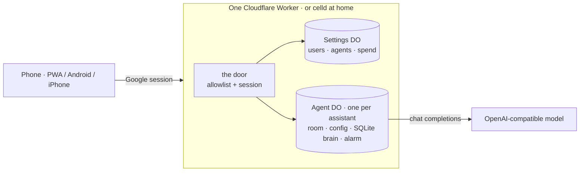

<p align="center">
  
</p>

<h1>
  <picture>
    <source media="(prefers-color-scheme: dark)" srcset="assets/logo.svg">
    
  </picture>
  gantree
</h1>

<p>
  <a href="https://github.com/shotah/gantree2/actions/workflows/ci.yml"></a>
  <a href="https://github.com/shotah/gantree2/actions/workflows/ci.yml"></a>
  <a href="https://github.com/shotah/gantree2/actions/workflows/harness.yml"></a>
  <a href="https://github.com/shotah/gantree2/actions/workflows/harness.yml"></a>
  <a href="https://github.com/shotah/gantree2"></a>
  <a href="LICENSE"></a>
</p>

The harness badge stays while [harness.yml](.github/workflows/harness.yml)
exists. That workflow is frozen with the Go tree pending cutover.

**Personal AI assistants with real tools, running where you say.** Your
Cloudflare account, or a box at home — same manifest. Sign in with
Google, add the people you trust, give each assistant a persona and the
tools it may touch, and talk to it from the browser, the Android app, or
the iPhone app. Fast to stand up, simple to run, yours to read. The
brain is TypeScript inside the Agent Durable Object. An assistant still
on `runtime: container` keeps the Go harness until you flip it.

The tree is the harness. The level bough is the hoist. The orange is what
it hands you.

## Why this one

- **No open ports. Ever.** A native assistant is the Agent Durable
  Object. Nothing listens on your network, and nothing is exposed to
  the internet but one Cloudflare Worker behind Google sign-in. An
  assistant still on the container dials *out* to that same room.
- **One door.** Google account, then an allowlist. An admin keeps the
  list on **Users**; a member sees only the assistants they were given.
  No passphrases, no second login, no role in the cookie.
- **Real tools, in the Worker.** Maps, Google (mail, calendar, docs,
  drive), Garmin, Strava, Google Health, image generation, feeds, X,
  rentals, math — twelve plugins in the same bundle as the brain. A
  missing key or login shows up as skipped. Keys live on the assistant,
  not in your repo. The container image is only for assistants still on
  `runtime: container`.
- **Memory you can open.** A native assistant keeps SQLite, persona,
  and `SELF.md` in its Durable Object. Edit them on the dashboard. A
  container assistant still snapshots `gantry.db` and `SELF.md` to R2.
- **A chat that follows you.** A PWA that installs on a phone, with
  push, voice, photos, and themes the assistant can set — and native
  Android and iPhone apps on the same room.
- **Provisioned, not configured.** One `wrangler.jsonc` describes the
  Worker, the Durable Objects, the KV, and the R2. The Harness container
  binding is still there for assistants on `runtime: container`.
  `wrangler deploy` for Cloudflare; `celld deploy` for the machine under
  your desk.

## A look

<table>
  <tr>
    <td width="50%"></td>
    <td width="50%"></td>
  </tr>
  <tr>
    <td align="center"><sub>Agents — every assistant on one board</sub></td>
    <td align="center"><sub>One assistant — status, persona, keys, tools, people, log</sub></td>
  </tr>
</table>

<table>
  <tr>
    <td width="25%"></td>
    <td width="25%"></td>
    <td width="50%"></td>
  </tr>
  <tr>
    <td align="center"><sub>Chat — on your phone, installed</sub></td>
    <td align="center"><sub>Pick an assistant</sub></td>
    <td align="center"><sub>Users — the allowlist, with an audit trail</sub></td>
  </tr>
</table>

More in [`assets/docs/`](assets/docs/): [sign-in](assets/docs/login.png) ·
[new assistant](assets/docs/agents-new.png) · [settings](assets/docs/settings.png) ·
[profile](assets/docs/profile.png).

## How it fits together



The Worker is the only thing on the internet. On `runtime: native` the
brain runs inside the Agent Durable Object: the turn, the twelve
plugins, persona, `SELF.md`, and the alarm that fires cron, watches,
and memory consolidation. It emits the same frames a crane socket used
to, so phones only ever see chat. An assistant left on
`runtime: container` still dials in from the Go harness and snapshots
to R2. Diagrams: [architecture](docs/architecture.md). The decision:
[brain](docs/brain.md). The morning's plan, kept as history:
[proposal](docs/proposal.md).

## Run it

```sh
cp .dev.vars.example .dev.vars   # Google client, SESSION_SECRET, GANTREE_ADMINS=you@example.com
npm ci
npm run dev                      # http://127.0.0.1:3000 — sign in, you land on /agents
```

Then **New agent**: a name, a persona (there is a template), the people
who may talk to it. Set **Runtime** to `native` on its dashboard — that
is the brain in the Durable Object, and it does not need Docker. Left
on `container`, the card goes green when the harness connects.
[install.md](docs/install.md) walks the Google client, Cloudflare, and
home setups; [access.md](docs/access.md) is the people side.

| Where | Command | What holds state |
| --- | --- | --- |
| Your laptop | `npm run dev` | Miniflare, under `.wrangler/` |
| Cloudflare | `npm run deploy` (CI on `main`) | Durable Objects · KV · R2 · Containers (legacy) |
| A box at home | `npm run deploy:home` ([celld](https://github.com/denoland/celld)) | celld's SQLite + an S3 bucket you own, behind Tailscale or a Tunnel |

```sh
npm run build && npm run start   # the built Worker under wrangler dev
npm test · npm run lint · npm run typecheck             # what CI runs
npm run eval                     # live-model eval; Vitest, brain/eval (docs/eval_setup.md)
```

`cd harness && docker build -t gantree-harness:local .` builds the
legacy container image. A native assistant does not use it.

## Tools in the box

Twelve plugins, in the Worker, named `{plugin}__{tool}`:

| | | |
| --- | --- | --- |
| **maps** — Google Maps | **google** — Gmail, Calendar, Docs, Drive | **google-health** |
| **garmin** | **strava** | **image** — generation |
| **feeds** — RSS / Atom | **twitter** — X | **rentals** |
| **flights** — Google Flights via SerpAPI | **math** | **chat** — the room itself |
| [custom servers](docs/custom-mcp.md) | | |

Each plugin is skipped until it has what it needs (a key, an OAuth
login). The dashboard lists published and skipped. Naming is a contract:
[mcp-naming.md](docs/mcp-naming.md) — a renamed tool fails the eval before
any model call. `mcp_enable` turns a prefix on for the chat; idle drops
are 6h and 27h. [mcp.md](docs/mcp.md).

## Reliability

Two coverage numbers, both published to `gh-pages` on every push to
`main` and shown above. **coverage** is the Worker (`lib/**`, `edge/**`,
`app/lib/**`; Vitest, 60 % floor in `vitest.config.ts`). **harness
coverage** stays while `harness.yml` exists. That workflow is frozen
with the Go tree: the harness and the baked-in plugins, one merged
profile. `HARNESS_COVERAGE_MIN` is the floor and only goes up. It is
not the native brain's number.

```sh
npm run test:coverage     # Worker, with the threshold gate
npm run coverage:harness  # harness + plugins, merged
npm run eval              # live-model behaviour eval, Vitest (docs/eval_setup.md)
```

ESLint is type-aware (`no-explicit-any`, `no-unsafe-*`, `no-deprecated`,
no global `Buffer`); a `"use client"` file that reaches a `node:` builtin
fails a test with the import chain named.

## Docs

Site: [github.bldhosting.com](https://github.bldhosting.com).
Same files under [`docs/`](docs/):

| Running it | The assistant | The rules |
| --- | --- | --- |
| [install](docs/install.md) · [access](docs/access.md) · [security](docs/security.md) · [troubleshooting](docs/troubleshooting.md) — door, keys, and the failures | [persona](docs/persona.md) · [channels](docs/channels.md) · [cron](docs/cron.md) · [reactions](docs/reactions.md) · [planner-siblings](docs/planner-siblings.md) · [connecting accounts](docs/auth.md) — what one assistant does | [architecture](docs/architecture.md) · [runtime](docs/runtime.md) · [brain](docs/brain.md) · [contract](docs/contract.md) · [mcp](docs/mcp.md) · [custom-mcp](docs/custom-mcp.md) · [mcp-naming](docs/mcp-naming.md) · [evals](docs/eval_setup.md) · [evaluation fable](docs/evaluation_fable.md) — the native brain, and the frozen container |

Plan and backlog: [proposal](docs/proposal.md) · [todo](docs/todo.md) ·
[done](docs/todo_done.md). Contributing: [CONTRIBUTING.md](CONTRIBUTING.md).
Found a hole: [SECURITY.md](SECURITY.md). Useful to you:
[sponsor](https://github.com/sponsors/shotah) — one person, nights.

## Layout

```
app/              routes, thin: login · agents · agents/new · agents/[slug] · chat · chat/[slug] · users · settings · profile · api/**
app/components/   agents/ · chat/ · users/ · settings/ · shared/
app/lib/          browser helpers: theme, prefs, sockets, push, spend
lib/door/         allowlist · users · google · session · gate · landing      the door
lib/chat/         room · bearer · frames · allow · push · membership          the room
lib/agents/       registry · config · status · container · tools · snapshot  the assistants
lib/theme/        fifteen themes, contrast gate                              from pendant
brain/            the native agent: core · agent loop · room · plugins
edge/             Durable Objects: Settings · Agent · Harness (legacy container)
worker/           the Worker entry: Vinext + /ws/<slug>
harness/          frozen Go harness + harness/mcp/<plugin>/ + Dockerfile
scripts/          icons · seed · shot · badge · pages · eval · coverage-harness
test/             mirrors lib/, app/, edge/, brain/, scripts/
```

## Lineage

gantree is the side-by-side successor to
[gantree](https://github.com/shotah/gantree) (settings),
[gantry-pendant](https://github.com/shotah/gantry-pendant) (chat), and
[ai-gantry](https://github.com/shotah/ai-gantry) (the harness) — three
repos folded into one product at one origin behind one door. Those keep
serving until cutover. Themes (**Boom**, **Paper**, **Ink**, and a
dark/light pair per mood) came over from the pendant; every pair meets AA
on the surfaces we paint, and `test/theme/catalog.test.ts` holds the line.
