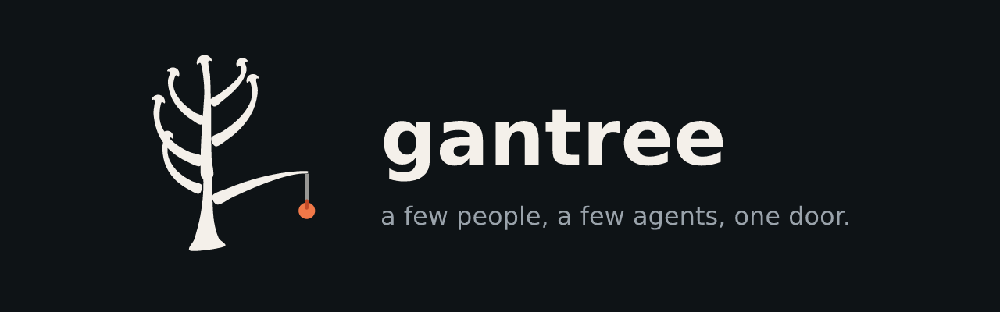
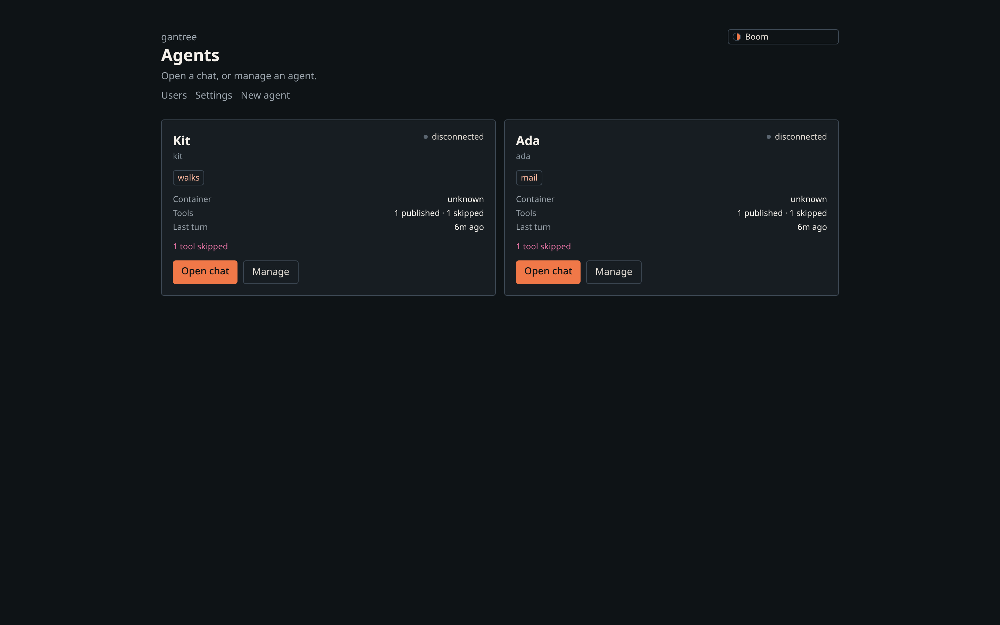
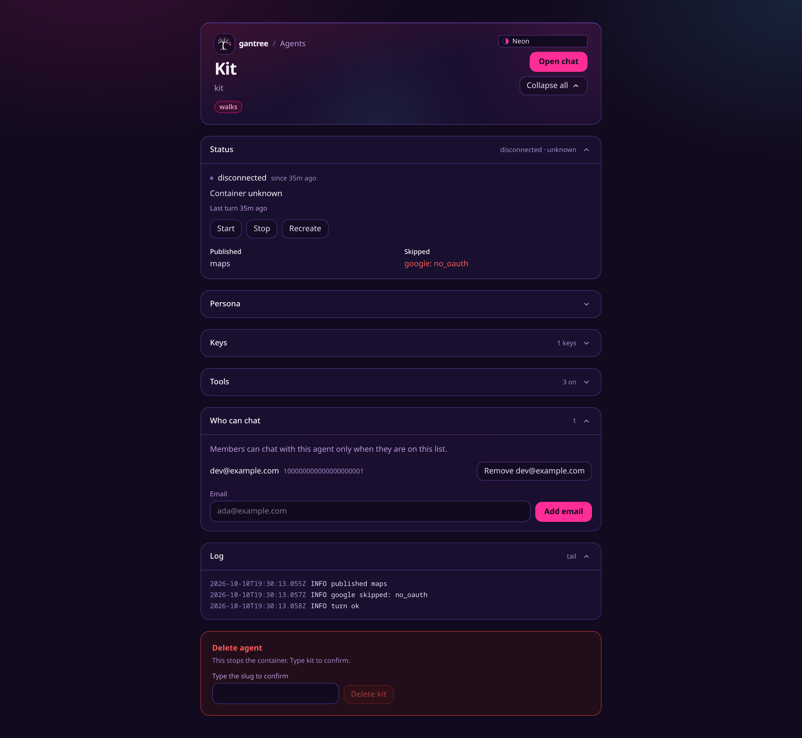
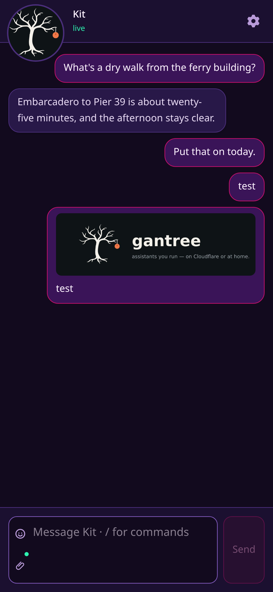
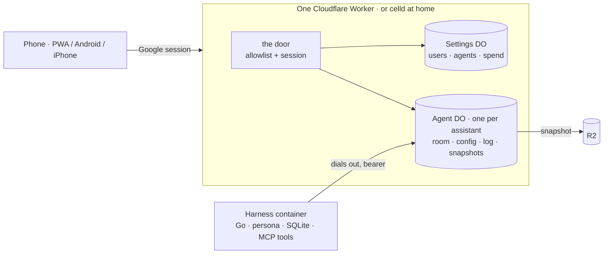

<p align="center">
  
</p>

<h1>
  <picture>
    <source media="(prefers-color-scheme: dark)" srcset="assets/logo.svg">
    
  </picture>
  gantree
</h1>

<p>
  <a href="https://github.com/shotah/gantree2/actions/workflows/ci.yml"></a>
  <a href="https://github.com/shotah/gantree2/actions/workflows/ci.yml"></a>
  <a href="https://github.com/shotah/gantree2/actions/workflows/harness.yml"></a>
  <a href="https://github.com/shotah/gantree2/actions/workflows/harness.yml"></a>
  <a href="https://github.com/shotah/gantree2"></a>
  <a href="LICENSE"></a>
</p>

**Personal AI assistants with real tools, running where you say.** Your
Cloudflare account, or a box at home — same manifest, same image. Sign in
with Google, add the people you trust, give each assistant a persona and
the tools it may touch, and talk to it from the browser, the Android app,
or the iPhone app. Fast to stand up, simple to run, yours to read.

The tree is the harness. The level bough is the hoist. The orange is what
it hands you.

## Why this one

- **No open ports. Ever.** The assistant runs in a container that dials
  *out* to its chat room. Nothing listens on your network, nothing is
  exposed to the internet but one Cloudflare Worker behind Google sign-in.
- **One door.** Google account, then an allowlist. An admin keeps the
  list on **Users**; a member sees only the assistants they were given.
  No passphrases, no second login, no role in the cookie.
- **Real tools, granted per assistant.** Maps, Google (mail, calendar,
  docs, drive), Garmin, Strava, Google Health, image generation, feeds,
  X, rentals, math — baked into one image, switched on per assistant in
  **Tools**. Keys live on the assistant, not in your repo.
- **Memory you can open.** Each assistant has a SQLite file and a
  `SELF.md` it edits. Snapshots land in your R2 bucket; **Recreate**
  restores from the last one.
- **A chat that follows you.** A PWA that installs on a phone, with
  push, voice, photos, and themes the assistant can set — and native
  Android and iPhone apps on the same room.
- **Provisioned, not configured.** One `wrangler.jsonc` describes the
  Worker, the Durable Objects, the KV, the R2, and the container. `wrangler
  deploy` for Cloudflare; `celld deploy` for the machine under your desk.

## A look

<table>
  <tr>
    <td width="50%"></td>
    <td width="50%"></td>
  </tr>
  <tr>
    <td align="center"><sub>Agents — every assistant on one board</sub></td>
    <td align="center"><sub>One assistant — status, persona, keys, tools, people, log</sub></td>
  </tr>
</table>

<table>
  <tr>
    <td width="25%"></td>
    <td width="25%"></td>
    <td width="50%"></td>
  </tr>
  <tr>
    <td align="center"><sub>Chat — on your phone, installed</sub></td>
    <td align="center"><sub>Pick an assistant</sub></td>
    <td align="center"><sub>Users — the allowlist, with an audit trail</sub></td>
  </tr>
</table>

More in [`assets/docs/`](assets/docs/): [sign-in](assets/docs/login.png) ·
[new assistant](assets/docs/agents-new.png) · [settings](assets/docs/settings.png) ·
[profile](assets/docs/profile.png).

## How it fits together



The Worker is the only thing on the internet. The harness dials *in* to
its room with a bearer the room minted; the room sends it its config,
keeps its log, and signs the URLs it uses to restore and snapshot its
memory. Phones only ever see chat. Diagrams and the long version:
[architecture](docs/architecture.md) · [proposal](docs/proposal.md).

## Run it

```sh
cp .dev.vars.example .dev.vars   # Google client, SESSION_SECRET, GANTREE_ADMINS=you@example.com
npm ci
npm run dev                      # http://127.0.0.1:3000 — sign in, you land on /agents
```

Then **New agent**: a name, a persona (there is a template), the tools it
may use, the people who may talk to it. Its card goes green when the
harness connects. [install.md](docs/install.md) walks the Google client,
Cloudflare, and home setups; [access.md](docs/access.md) is the people
side.

| Where | Command | What holds state |
| --- | --- | --- |
| Your laptop | `npm run dev` | Miniflare, under `.wrangler/` |
| Cloudflare | `npm run deploy` (CI on `main`) | Durable Objects · KV · R2 · Containers |
| A box at home | `npm run deploy:home` ([celld](https://github.com/denoland/celld)) | celld's SQLite + an S3 bucket you own, behind Tailscale or a Tunnel |

```sh
npm run build && npm run start   # the built Worker under wrangler dev
cd harness && docker build -t gantree-harness:local .   # the assistant image; rootless podman works
npm test · npm run lint · npm run typecheck             # what CI runs
```

## Tools in the box

Twelve MCP servers, one image, switched on per assistant:

| | | |
| --- | --- | --- |
| **maps** — Google Maps | **google** — Gmail, Calendar, Docs, Drive | **google-health** |
| **garmin** | **strava** | **image** — generation |
| **feeds** — RSS / Atom | **twitter** — X | **rentals** |
| **flights** — Google Flights via SerpAPI | **math** | **chat** — the room itself |
| [custom servers](docs/custom-mcp.md) | | |

Each lists what it needs (a key, an OAuth client) and the dashboard tells
you what is missing before the assistant tries. Naming is a contract:
[mcp-naming.md](docs/mcp-naming.md) — a renamed tool fails the eval before
any model call.

## Reliability

Two coverage numbers, both published to `gh-pages` on every push to
`main` and shown above. **coverage** is the Worker (`lib/**`, `edge/**`,
`app/lib/**`; Vitest, 60 % floor in `vitest.config.ts`). **harness
coverage** is the Go harness *and every baked-in plugin*, merged into one
profile — an untested plugin lowers the number instead of hiding behind
its own badge. `HARNESS_COVERAGE_MIN` in `harness.yml` is the floor.

```sh
npm run test:coverage     # Worker, with the threshold gate
npm run coverage:harness  # harness + plugins, merged
npm run eval              # live-model behaviour eval; the release gate (docs/eval_setup.md)
```

ESLint is type-aware (`no-explicit-any`, `no-unsafe-*`, `no-deprecated`,
no global `Buffer`); a `"use client"` file that reaches a `node:` builtin
fails a test with the import chain named.

## Docs

Site: [github.bldhosting.com](https://github.bldhosting.com).
Same files under [`docs/`](docs/):

| Running it | The assistant | The rules |
| --- | --- | --- |
| [install](docs/install.md) · [access](docs/access.md) · [security](docs/security.md) · [troubleshooting](docs/troubleshooting.md) | [persona](docs/persona.md) · [channels](docs/channels.md) · [cron](docs/cron.md) · [reactions](docs/reactions.md) · [planner-siblings](docs/planner-siblings.md) · [connecting accounts](docs/auth.md) | [architecture](docs/architecture.md) · [contract](docs/contract.md) · [mcp](docs/mcp.md) · [custom-mcp](docs/custom-mcp.md) · [mcp-naming](docs/mcp-naming.md) · [evals](docs/eval_setup.md) · [evaluation fable](docs/evaluation_fable.md) |

Plan and backlog: [proposal](docs/proposal.md) · [todo](docs/todo.md) ·
[done](docs/todo_done.md). Contributing: [CONTRIBUTING.md](CONTRIBUTING.md).
Found a hole: [SECURITY.md](SECURITY.md). Useful to you:
[sponsor](https://github.com/sponsors/shotah) — one person, nights.

## Layout

```
app/              routes, thin: login · agents · agents/new · agents/[slug] · chat · chat/[slug] · users · settings · profile · api/**
app/components/   agents/ · chat/ · users/ · settings/ · shared/
app/lib/          browser helpers: theme, prefs, sockets, push, spend
lib/door/         allowlist · users · google · session · gate · landing      the door
lib/chat/         room · bearer · frames · allow · push · membership          the room
lib/agents/       registry · config · status · container · tools · snapshot  the assistants
lib/theme/        fifteen themes, contrast gate                              from pendant
edge/             Durable Objects: Settings · Agent · Harness (container)
worker/           the Worker entry: Vinext + /ws/<slug>
harness/          the Go harness + harness/mcp/<plugin>/ + Dockerfile
scripts/          icons · seed · shot · badge · pages · coverage-harness
test/             mirrors lib/, app/, edge/, scripts/
```

## Lineage

gantree is the side-by-side successor to
[gantree](https://github.com/shotah/gantree) (settings),
[gantry-pendant](https://github.com/shotah/gantry-pendant) (chat), and
[ai-gantry](https://github.com/shotah/ai-gantry) (the harness) — three
repos folded into one product at one origin behind one door. Those keep
serving until cutover. Themes (**Boom**, **Paper**, **Ink**, and a
dark/light pair per mood) came over from the pendant; every pair meets AA
on the surfaces we paint, and `test/theme/catalog.test.ts` holds the line.
