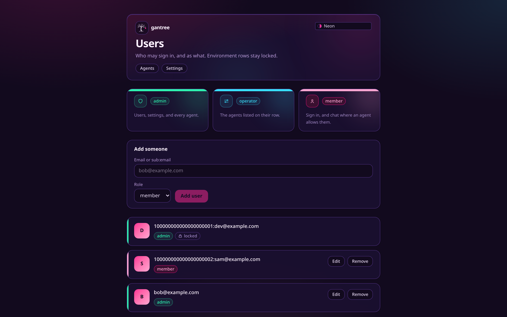
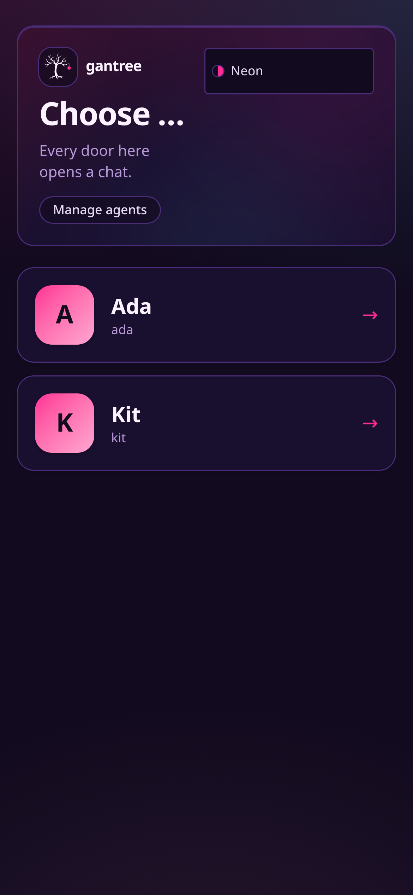

# Access — who may operate, who may talk

One repo, one door, one household. This page is how a **person** lines
up across settings, chat, and the agent: the Google sign-in, the list
that says whether you may be here, the role that says what you may
touch, and the room list each agent obeys.

Pictures: [architecture.md](architecture.md) §2–§4 and §6. Why the
door is Google and not a passphrase: [proposal.md](proposal.md#auth-one-door).
Setup by place: [install.md](install.md). Open walks: [todo.md](todo.md).

---

## Two populations, one sign-in

| Who | Wants | Needs |
| --- | --- | --- |
| **Operators** | to *touch* an agent — config, tools, recreate, users | a Google account on the list with role `admin` or `operator` |
| **Members** | the agent to *answer* | a Google account on the list; chat also needs the room list unless they are in `GANTREE_ADMINS` or `GANTREE_ALLOW` |

Bob can operate Ada and never message her. Sam can message Ada from
a phone and never see settings. Both sign in at the same `/login`.
There is no second door and no passphrase.






```text
            Google sign-in  →  gantree_session {sub, email}
                                     │
                     gate, every request (never from the cookie)
                                     │
         ┌───────────────────────────┼────────────────────────────┐
   GANTREE_ADMINS           GANTREE_ALLOW              Settings DO users
   admin · locked           member · locked            admin / operator(agents) / member
         └───────────────────────────┼────────────────────────────┘
                                     │  role
         /users /settings  admin ────┤
         /agents/<id>      admin, or operator with <id> in agents[]
         /chat/<id>        any role  ──┐
                                       └─ on that agent's room list, or on
                                          GANTREE_ADMINS / GANTREE_ALLOW
                                          (operators and other Settings-only
                                          people still need a room row)
```

---

## The principle

**One identity (`sub`), one app list, one room list per agent, every
check at request time.**

- Google proves *who*. It never says *whether*.
- The app list (env floor ∪ Settings DO rows) says whether you may be
  here at all, and with what role.
- The agent's room list says whether that agent will talk to you. It
  lives on the Agent DO. Settings edits it. The brain publishes it as
  an `allow` frame. Nothing else does. People in `GANTREE_ADMINS` or
  `GANTREE_ALLOW` may chat with every agent even when that list is empty;
  everyone else still needs a row on it.
- A cookie only proves who. Removing a person from a list ends their
  access on the next request, not at cookie expiry.

---

## Shared contract

Every piece of this repo — and gantree-android and gantree-ios —
codes to this section. Change it here first.

### Allowlist entry grammar

Comma or whitespace separated. Three forms. Same grammar for
`GANTREE_ADMINS`, `GANTREE_ALLOW`, Settings DO rows, and every
agent's `PENDANT_ALLOWED_USERS`.

| Entry | Parse |
| --- | --- |
| `118212345678901234567` | `sub` = 10–32 digits |
| `118212345678901234567:ada@example.com` | split at the **first** `:`; `sub` left, email right (lowercased) |
| `ada@example.com` | no `:` and contains `@` → email only, lowercased |

Normalize: trim, drop empties, dedupe by `sub` then by email. Junk is a
dropped entry with a warning in settings. Code: `lib/door/allowlist.ts`.

### Matching

| Entry has | Matches when |
| --- | --- |
| `sub` | `sub` equals the token's `sub`, exactly |
| `email` | token's `email_verified` is true **and** lowercased `email` equals, exactly. No Gmail-dot or `+tag` folding. |
| both | either |

`sub` is the key: it survives an email change. Email is an alias: it
only ever *matches*, never *identifies*. Session ids and `user_id` on
frames are always `sub`.

### Roles

| Role | From | May |
| --- | --- | --- |
| `admin` | `GANTREE_ADMINS` (locked) or a Settings row | `/users`, `/settings`, every agent. An identity in `GANTREE_ADMINS` may chat with every agent; a Settings-only admin still needs that agent's room list. |
| `operator` | Settings row with `agents[]` | `/agents/<agent id>` for listed ids; chat where the room list allows |
| `member` | `GANTREE_ALLOW` (locked) or a Settings row | An identity in `GANTREE_ALLOW` may chat with every agent; a Settings-only member still needs that agent's room list. `/api/auth/me` |

Resolution is per request: collect every row that matches, take the
highest role, union the operators' `agents[]`. Env rows are **locked**:
settings shows them and cannot remove them; edit the env to change
them. Empty `GANTREE_ADMINS` → every gated route is `503` until it is
set. Code: `lib/door/users.ts`.

### Cookies

| Cookie | Holds | Life | Flags |
| --- | --- | --- | --- |
| `gantree_oauth` | `state`, `nonce`, `code_verifier`, `next` | 10 min | `HttpOnly; Secure; SameSite=Lax; Path=/` |
| `gantree_session` | `{ sub, email }` | **7 days, hard** | same |

Both are JWE (`dir` + `A256GCM`); key = SHA-256 of `SESSION_SECRET`
(≥ 32 chars). `Secure` is dropped only on loopback `http`. Nothing else
is in the cookie: no role, no agents, no name. Code: `lib/door/session.ts`.

### Google

Authorization Code + PKCE (`S256`), scopes `openid email profile`,
`prompt=select_account`. ID token verified with `jose`: `iss` in
`accounts.google.com` / `https://accounts.google.com`, `aud` =
`GOOGLE_CLIENT_ID`, `exp`, signature from Google's JWKS, and our
`nonce`. Nobody decodes a JWT by hand. Code: `lib/door/google.ts`.

### Gate, every non-public request

| Situation | Page | `/api/*`, `/ws/*` |
| --- | --- | --- |
| public path | through | through |
| no admins configured | `503` | `503` |
| no / bad / expired cookie, and no bearer that opens | `302 /login?next=<path>` | `401 {"error":"unauthorized"}` |
| cookie or bearer, not on any list | `401` | `401` |
| on a list | through, `x-gantree-sub/email/role/agents` set | same |

Public: `/login`, `/api/auth/google`, `/api/auth/callback/google`,
`/api/auth/catch`, `/api/auth/config`, `/api/auth/nonce`, `/api/auth/token`,
`/manifest.webmanifest`, `/sw.js`, `/icon.svg`, `/favicon.ico`,
`/robots.txt`, `/_vinext/*`, `/_next/*`, `/assets/*`, `/.well-known/*`.
Code: `lib/door/gate.ts`, `lib/door/http.ts`, `middleware.ts`. A cookie
that opens wins; otherwise the same JWE on `Authorization: Bearer`.
A bearer on `/api/chat/{avatar,backdrop,theme}` is the room token
(`isAgentRoomRequest`) and is let through before that read.
`/api/auth/catch` is on the public list so a missing cookie is a
plain-text 401. The handler still requires the session cookie.

### `/api/auth/me`

```json
{ "sub": "118212345678901234567", "email": "ada@example.com",
  "role": "member", "agents": ["ada"] }
```

`agents` for a member is the agent ids whose room list has them (KV
directory `sub:<sub>` / `email:<email>` → agent ids, written by each Agent
DO when it stores an `allow` frame). For an operator it is their
assignment. For an admin it is every agent id. gantree-android and
gantree-ios read `agents` and fall back to `cranes`; the alias is
still written until the Phase 4 wire-name drop. The only identity a stranger sees
is their own.

### Phones (native sign-in)

gantree-android (`com.gantree.cab`) and gantree-ios (`com.gantree.helm`)
call config → nonce → Google with that nonce → token → `/api/auth/me`
→ `/ws/<agent id>?role=phone` with the bearer. On 403 they store nothing
and show the sub; on socket close 4401 they drop the JWE, and on 4403
they keep it. These three routes are public and do not read or set a
cookie. Code: `lib/door/native.ts`.

| Route | Status | Body |
| --- | --- | --- |
| `GET /api/auth/config` | 200 | `{ mode, google, voice, version, dev }` |
| `GET /api/auth/nonce` | 200 | `{ nonce }` |
| `GET /api/auth/nonce` | 503 | `{"error":"not_configured"}` |
| `POST /api/auth/token` | 400 | `{"error":"bad_request"}` |
| `POST /api/auth/token` | 503 | `{"error":"not_configured"}` |
| `POST /api/auth/token` | 401 | `{"error":"nonce"}` |
| `POST /api/auth/token` | 401 | `{"error":"token"}` |
| `POST /api/auth/token` | 403 | `{"error":"not_allowed", sub, email}` |
| `POST /api/auth/token` | 200 | `{ token, sub, email, exp }` |

`mode` is `"google"` when `GOOGLE_CLIENT_ID` and `SESSION_SECRET` are
both set, otherwise `"spike"`. `voice` is true only when
`GOOGLE_TTS_API_KEY` is set and `VOICE` is not `off`. `version` is
`package.json` via `app/lib/release.ts`. `dev` is loopback.

The nonce is server-issued and stateless: a compact JWE sealed with
the session key, audience `nonce`, 10-minute TTL, no KV or DO row, and
a replay inside that TTL is accepted. Nonce `503` means
`SESSION_SECRET` is missing.

The token is the `gantree_session` JWE (7-day TTL) on
`Authorization: Bearer`, and `exp` is epoch seconds. `401` `nonce`
means the posted nonce is not ours or is expired. `401` `token` means
the ID token failed signature, issuer, `aud`, `exp`, or its nonce
claim ≠ the posted nonce. `aud` must be `GOOGLE_CLIENT_ID`, the web
client id the apps pass as `serverClientId` / `GIDServerClientID`.
Token `503` means `GOOGLE_CLIENT_ID` or `SESSION_SECRET` is missing.

A stranger gets 403 `not_allowed` with only their own `sub` and
`email`, and no session.

The gate takes the bearer wherever it takes the cookie. A cookie that
opens wins; a cookie that does not falls through to the bearer.
`isAgentRoomRequest` still runs first: a bearer on
`/api/chat/{avatar,backdrop,theme}` is the room token, not a
session.

### Room admission (`/ws/<agent id>`)

| Check | Where | On miss |
| --- | --- | --- |
| phone: session opens (cookie, else the same JWE on `Authorization`) and the person is on the app list | handshake, every frame | `4401` |
| phone: `sub` ∈ room list **or** (`email_verified` ∧ `email` ∈ room list) | handshake, every frame | `4403` |

Room list = last `allow` frame stored on that agent's Durable Object. New
`allow` → re-check every phone socket; close the ones no longer on it.
Admins are **not** exempt from the room list: operating Ada and
talking to Ada are different grants.

### Frames (brain ↔ room)

The brain emits these inside the DO. The DO fans the phone-facing kinds.

Brain → room, right after `cmds`, and again when the allow list changes:

```json
{ "kind": "allow", "users": [
  { "sub": "118212345678901234567", "email": "ada@example.com" },
  { "email": "bob@example.com" }
] }
```

Room → brain, `email` beside `user_id`. The phone kind is `inbound`:

```json
{ "kind": "inbound", "user_id": "118212345678901234567",
  "email": "ada@example.com", "text": "…" }
```

The DO admits the socket when `user_id` **or** a verified `email` is on
the room list, then stamps `user_id` before the brain sees the frame.
The brain keeps one session id, `agent`, a row label in that agent's
database. `pendant:<agent id>:<sub>` is the alias until Phase 4.

---

## Seeding — where the first people come from

| Place | `GANTREE_ADMINS`, `GANTREE_ALLOW`, `GOOGLE_CLIENT_ID` | `GOOGLE_CLIENT_SECRET`, `SESSION_SECRET` |
| --- | --- | --- |
| Local dev | `.dev.vars` | `.dev.vars` |
| Cloudflare | GitHub Actions **variables** → `wrangler deploy --var` | GitHub Actions **secrets** → `wrangler secret bulk` |
| Home (celld) | `CELLD_VARS_FILE` | `CELLD_VARS_FILE` |

The env is the floor. Everyone else is a row on the Settings DO, added
on `/users` by an admin. Never commit `.dev.vars`.

### Dev without Google

`GANTREE_DEV_USER=118212345678901234567:you@example.com` in `.dev.vars`
fakes a signed-in session **only** when the request host is
`127.0.0.1` / `localhost`. The gate refuses it on any other host. The
dev user still has to be on a list.

---

## End to end

### Once

1. GCP → APIs & Services → Credentials → OAuth client ID → **Web
   application**. Scopes `openid email profile`. One client can carry
   every redirect below. Table: [install.md](install.md#google-oauth-client).
2. Put `GOOGLE_CLIENT_ID`, `GOOGLE_CLIENT_SECRET`, `SESSION_SECRET`,
   and your email in `GANTREE_ADMINS` where that place reads them.
3. Deploy. Open `/`. Sign in. You are admin.

### Add an operator

`/users` → add `bob@example.com`, role `operator`, agents `ada`. Bob
signs in; `/agents/ada` opens; `/agents/sam` is `401`; `/users` is
`401`. No redeploy.

### Add a human to Ada

1. `/agents/ada` → Users fold → tick Bob, or type an email for someone
   who is not on the app list yet (settings adds them as `member` on
   the same save). Settings writes the room list. An env change drops
   the memoised brain and opens a new one.
2. The brain publishes `allow`. The DO stores it and indexes the email
   in KV.
3. Sam opens `/chat/ada` on a phone. `/api/auth/me` says
   `agents: ["ada"]`. First frame carries `user_id` + `email`; Ada
   matches the email and answers.
4. Ada's `perf` frame carries `user_id`. Spend shows a raw `1182…` next
   to Sam's email and offers to store it. Accept; the row becomes
   `sub:email`.

### Yank

1. Untick on Ada's Users fold. The shorter `allow` closes Sam's socket
   `4403`.
2. Remove from `/users` (or the env). Her next request anywhere is
   `401`; her cookie is worthless even though it has not expired.
3. Stolen phone: OS lock, Google → sign out other sessions, then 2.

### Email change

The `sub` did not change. A `sub:email` row only needs a relabel. An
`email`-only row stops matching — update it. This is why settings
learns the `sub` when it can.

---

## What we gave up, and what we keep

The originals kept a passphrase on settings so the Mini would open
when `accounts.google.com` did not. gantree2 drops that on purpose.

| Concern | Now |
| --- | --- |
| Google down | Existing 7-day sessions keep working; new sign-ins wait. |
| Redirect URI at home | Google rejects LAN IPs. A home box needs Tailscale HTTPS or a Tunnel in front of celld. [install.md](install.md#home-celld). |
| First boot | No `/setup`. `GANTREE_ADMINS` in the env is the first admin. |
| Still a list | Yes. Google proves who; the list says whether; the role says what. |

Kept from the originals: the grammar, `sub` as the key, verified email
as an alias, fail closed, no enumeration, bearer per agent, the room
list as the agent's own policy.

---

## Threats

| Change | Risk | Why it is acceptable |
| --- | --- | --- |
| The brain publishes `allow` | The room list is that agent's policy | Ada's list cannot touch Sam's agent id. |
| Session for any verified Google account | Strangers hold a cookie | It opens nothing: the gate re-checks the list on every request. Same `unauthorized` for every miss; the only id shown is your own. |
| Email as alias | Someone else's Google account with that email? | Google verifies `email` on its own accounts. Exact, lowercased, `email_verified` required. Workspace `hd` is a later knob. |
| Room list remembered | Yank is the next `allow` | Removing the person from `/users` is instant for everything else. |
| One IdP | Google outage blocks new logins | Sessions are 7 days; the originals' passphrase door is the escape hatch until Phase 4, after which an admin's live session is. |
| Stateless nonce | Replay of a (nonce, id_token) pair within 10 minutes | The ID token is the proof of identity and is itself short-lived; the session minted is identical; no state to exhaust. |

What stays: no inbound port, no Cloudflare API token in settings, no
MCP OAuth token doubling as a login, no role in the cookie.

---

## Not this

| Shape | Why not |
| --- | --- |
| Passphrase or magic-link second door | Two doors is how the originals ended up with three ideas of a person. |
| Role in the cookie | Removal must be instant. The list is read every request. |
| Cloudflare Access in front of the Worker | 403s WebSocket upgrades; a second identity system. |
| Pairing codes in chat | Lists, not handshakes. |
| Admins bypass the room list | Operating and talking are different grants. Ada's humans are Ada's list. |

## Fit gates

Fail one and the task is later, or wrong.

1. **One sign-in.** Google, verified with `jose`. The browser is PKCE;
   the phones post an ID token. Nothing else issues a session.
2. **One app list, one room list per agent.** Env floor ∪ Settings DO
   rows; the room list on the Agent DO. No fourth copy.
3. **`sub` is the key, verified email is an alias.**
4. **Role every request, never from the cookie.**
5. **Fail closed.** No admins → `503`. Empty room list → nobody talks.
6. **No enumeration.** Same miss for everyone; you only ever see your
   own id.
7. **Isolation.** Adding a person to Ada does not touch Sam.
8. **`allow` is a frame on the room.** Settings writes the list; the
   brain publishes it.
