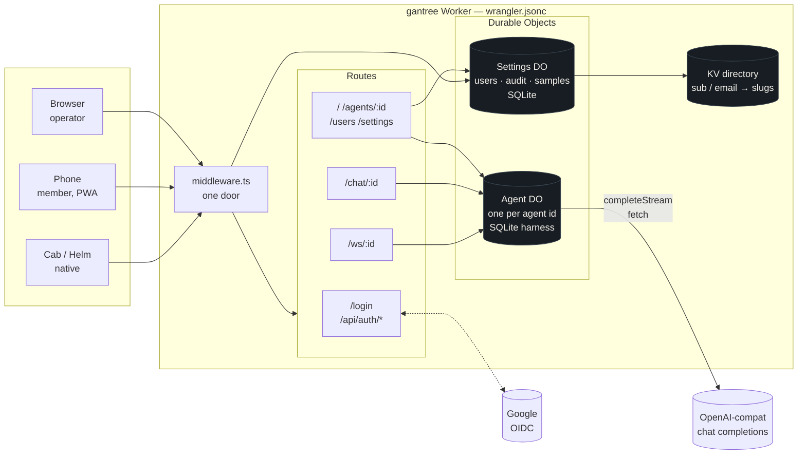
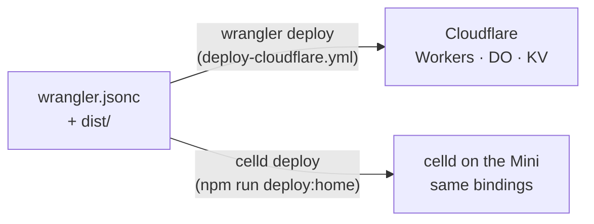
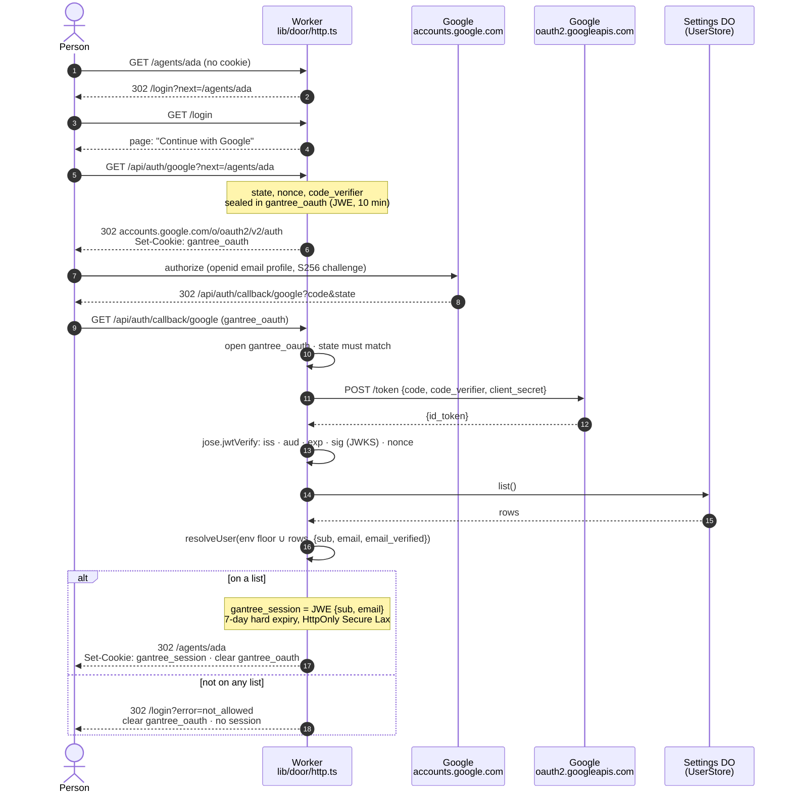
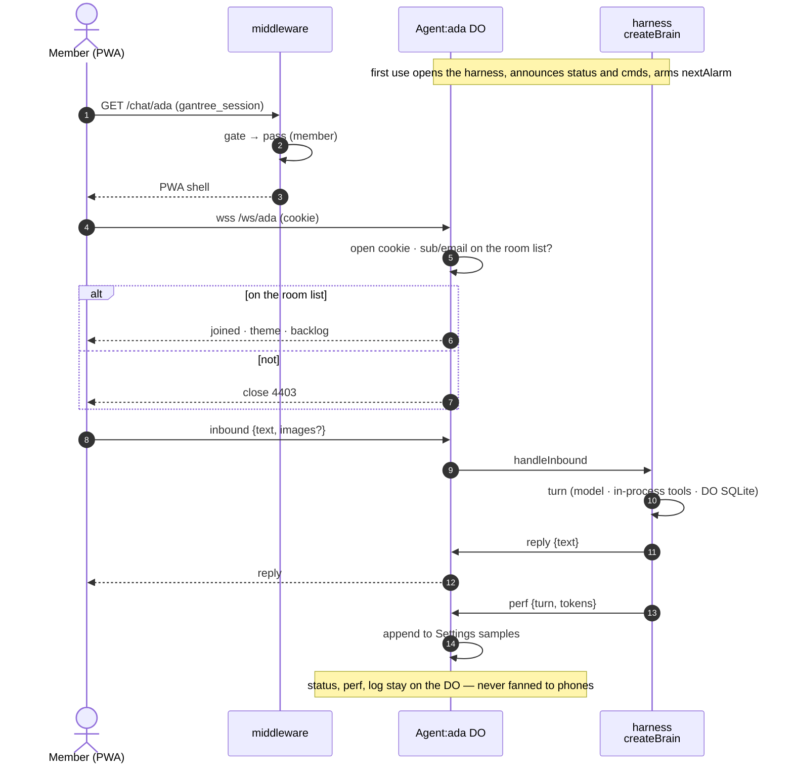
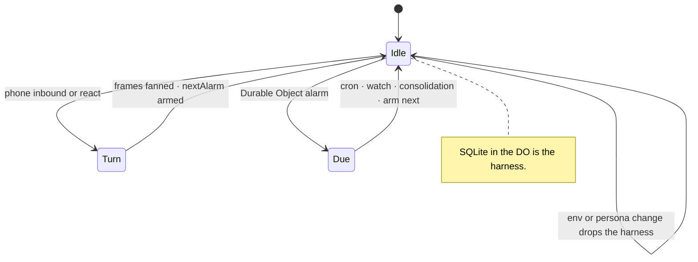
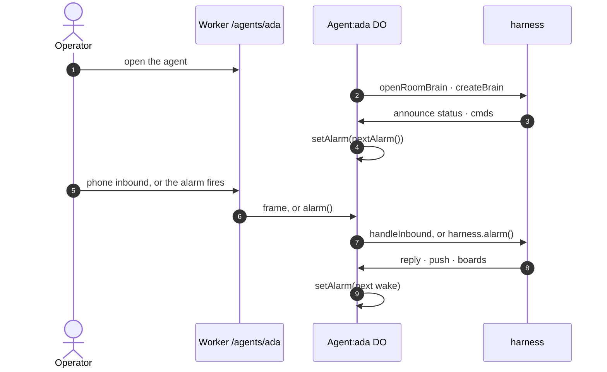
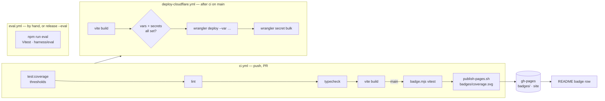
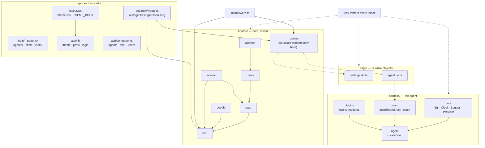

# Architecture

How gantree is put together: the pictures, then the choices that stay
true as it grows. The reasoning behind the shape is in
[proposal.md](proposal.md) (the morning's plan) and
[harness.md](harness.md) (the runtime that was built). Who may do what is
in [access.md](access.md); where it runs is in [install.md](install.md).
When this file and the proposal disagree about the runtime, this file
and [harness.md](harness.md) win.

Vocabulary: **settings** (what operators see), **chat** (the PWA a
member talks through), **agents** (one Durable Object each), **harness**
(the TypeScript loop inside that object), **users** (one list, three
roles). Wire names are `CHAT_*`, `agents`, `chat:<agent id>:`.
`PENDANT_*`, `CHANNEL=pendant`, and `cranes` are aliases until the
Phase 4 wire-name drop and are marked where they appear.

## 1. The product

One Worker, one manifest, two places it runs. The harness is the Agent
Durable Object: no second process, no image, and no socket between the
harness and the room. `edge/agent.do.ts` builds it with `openRoomBrain`
(`harness/room`) and `createBrain` (`harness/agent`). The contract is
`harness/core`: `Sql` on `ctx.storage.sql`, `Clock`, `Logger`,
`ChatProvider` (`openai` at major 7, against `LLM_BASE_URL`,
`LLM_API_KEY`, `LLM_MODEL`), and `Plugin` / `Tool`.

The twelve tools are in-process modules under `harness/plugins`, not
child processes: `chat`, `feeds`, `flights`, `garmin`, `google`,
`google-health`, `image`, `maps`, `math`, `rentals`, `strava`,
`twitter`. The model sees `{plugin}__{tool}` (`google__calendar_list_events`).
Schemas stay off until `mcp_enable`; a brief hold drops after 6 hours
idle, a short hold after 27. Plugin tools take a set and return a list
(`.cursor/rules/harness-plugins-plural.mdc`). `GARMIN_TOOL_TIER`
(`core`, `extended`, `complete`; empty stays `core`) and
`GOOGLE_TOOL_PRESET` (`lean`, `everyday`, `all`; empty stays
`everyday`) narrow those two catalogs. A plugin that cannot serve is
skipped, not spawned: `no_key`, `no_oauth`, `disabled`, or `error`,
on the `status` frame.

Cron, watches, and memory consolidation share the Agent DO alarm.
`nextAlarm()` is the soonest due instant; `alarm()` calls
`harness.alarm()`, which runs due work and returns the next wake. Cost
between fires is zero.

Phone-facing frames are `reply`, `draft`, `typing`, `react`, `cmds`,
`aims`, `todo`, `allow`, and `push`. `status`, `perf`, and `log` stay
on the DO.

Persona and `SELF.md` are SQLite rows: `persona_file` and `selfnote`.
The first open copies `config.persona` into `PERSONA.md` once, and
only when the table is empty and the text is non-blank. After that
the row is the text.
Operators edit them on the dashboard folds and at
`GET` / `PUT` / `DELETE /api/agents/<agent id>/persona` and
`GET` / `PUT /api/agents/<agent id>/self`.

OAuth for Google, Google Health, and Strava finishes at
`GET /api/auth/catch?state&code`. `/auth <plugin>` and the Tools-fold
Connect button (`POST /api/agents/<agent id>/auth/start`) return the
provider URL with `state` sealed as an `oauth-catch` JWE
(agent id and plugin). The catch requires the `gantree_session` cookie
and an admin or a member of that room, calls `authFinish`, and posts
`<plugin> connected` into the room. Google and Google Health
register exactly `https://gantree2.bldhosting.com/api/auth/catch`
and `http://127.0.0.1:3000/api/auth/catch` (no trailing slash).
Strava's Authorization Callback Domain is the hostname only.
`PUBLIC_ORIGIN` overrides the host. Garmin is email, password, and
MFA, not this redirect. Detail: [auth.md](auth.md).

Two deploy targets, same Worker:

On Cloudflare the Worker runs on Cloudflare's platform. At home
**celld** runs that same platform. The manifest declares the Worker,
the Durable Objects, and the KV directory.

| | Cloudflare | Home |
| --- | --- | --- |
| Worker, DOs, KV | Cloudflare | celld |
| Harness | Agent Durable Object | the same class under celld |
| What you type | `wrangler deploy` | `celld deploy` |

The harness is TypeScript because the isolate is JavaScript, the Durable
Object class is JavaScript, and a turn is waiting on the model and on
`fetch`. Why Go-in-WASM lost is [harness.md](harness.md).

Behavioral eval is Vitest: `harness/eval`, `npm run eval`. Setup:
[eval_setup.md](eval_setup.md).

## One agent, one Durable Object

Each agent is one Durable Object, looked up by that agent's id.
`agentStub` in `lib/chat/location.ts` is the only Agent lookup:
`env.AGENT.idFromName(<agent id>)`, then `get`. Chat, the agents
HTTP API, avatars, membership, and the OAuth catch all go through
it. `app/api` does not name an object itself.

The Settings object is the one shared name, `settings`, on purpose.
`lib/door/runtime.ts`, `lib/agents/http.ts`, and the sample write in
`edge/agent.do.ts` use `getByName("settings")`, or
`idFromName("settings")` when `getByName` is missing. That object
holds users, audit, samples, and the agent directory.

`ctx.storage.sql` is that object's own SQLite. Two agents do not
share a database, so they do not share sessions, memory, cron,
watches, tokens, or pins. The conversation id in those tables is
that agent's id. An empty id is the label `agent`. Either string
is a row label inside one object, not a key that reaches another
agent. Opening the session, message, watch, cron, preference,
enable, and location stores rewrites the old label `gantry`, and
any other leftover mouth id, onto that conversation id.

KV maps a person to the agent ids they may open. It does not hold
the harness.

## 2. Request path — the door

Every non-public request passes `lib/door/gate.ts`. It is pure:
request + env + store in, decision out. `lib/door/http.ts` turns the
decision into a `Response`; `middleware.ts` is one line.

A cookie that opens wins; otherwise `Authorization: Bearer` is the
same session JWE. A bearer on `/api/chat/{avatar,backdrop,theme}` is
the room token (`isAgentRoomRequest`) and is let through before either
of those reads. `/api/auth/catch` is on the public list so a missing
cookie is a plain-text 401, not an HTML login redirect. The handler
still requires that cookie.

`GET /ws/<slug>` is handled in `worker/index.ts` before this middleware
path, so the mailbox authenticates on its own.

Role, every request, never from the cookie:

| Source | Role | Locked |
| --- | --- | --- |
| `GANTREE_ADMINS` (env) | admin | yes — settings cannot remove |
| `GANTREE_ALLOW` (env) | member | yes |
| Settings DO `users` rows | admin / operator(agents) / member | no |

## 3. Sign-in — Google, PKCE, two cookies

Every miss (`expired`, `state`, `exchange`, `token`, `not_allowed`)
bounces to `/login?error=` and never sets a session. The only identity
a stranger ever sees is their own.

## 4. Chat — phone to the harness through the Agent DO

The Agent DO is the room. A phone joins with the session — the cookie,
or the same JWE on `Authorization` — plus that agent's own list. There
is no second socket. The DO hands `inbound` and `react` to
`harness.handleInbound` and fans the frames the harness emits.

Native sign-in ([access.md](access.md#phones-native-sign-in)):

The PWA sends the cookie. The turn never leaves the DO:

## 5. Agent lifecycle — the DO is the harness

An env or persona change drops the memoised harness and opens a new one,
then arms the alarm again.

## 6. Users — one list, three roles

Seeding, by place:

| Where | `GANTREE_ADMINS` / `GANTREE_ALLOW` / `GOOGLE_CLIENT_ID` | `GOOGLE_CLIENT_SECRET` / `SESSION_SECRET` |
| --- | --- | --- |
| Local | `.dev.vars` | `.dev.vars` |
| Cloudflare | Actions **variables** → `wrangler deploy --var` | Actions **secrets** → `wrangler secret bulk` |
| Home | `CELLD_VARS_FILE` | `CELLD_VARS_FILE` |

## 7. Build and ship

`publish-pages.sh` replaces only the paths it is handed. Home deploy
is a human running `npm run deploy:home`; GitHub cannot reach the Mini.
Live eval setup is [eval_setup.md](eval_setup.md).

## 8. Code map

The coverage badge counts `lib/**`, `edge/**`, `app/lib/**`. Harness
suites live under `test/harness/` and run with `npm test`; they are not
in that badge's include. `lib/door/runtime.ts` is the one excluded
file: it imports `cloudflare:workers` and has nothing to assert.

## 9. Why this shape

**One Worker, not three repos.** Settings and chat are one Vinext app
on Workers, and state is Durable Objects.

**Why the harness is the Agent DO.** The agent is always available and
is not billed while idle. The DO wakes in milliseconds, costs nothing
between alarms, and keeps SQLite that outlives the invocation. The
loop, the plugins, and the clock run in that object. The record is
[harness.md](harness.md).

**Why Durable Objects, not D1.** One actor per agent is the natural
unit: its config, its room, its bearer, its alarm, and its harness.
Settings is one more actor. Nothing is shared except the KV directory.

## 10. Choices that stay true

If a task fails one of these, it is later, or it is wrong.

1. **One door.** Google signs you in; one list says whether; a role
   says what; each agent's room list says who it talks to, except
   `GANTREE_ADMINS` and `GANTREE_ALLOW` may chat with every agent.
   Role is computed every request, never read from the cookie. No second
   login. [access.md](access.md).
2. **The Agent DO is truth.** `config.env`, the room list, and the
   bearer live on the DO. Persona rows, `SELF.md`, sessions, memory,
   cron, watches, and OAuth tokens live in that DO's SQLite. Settings
   edits them through the DO. No file on a host, no second inventory.
3. **The harness does not listen.** A turn is a method call inside the
   DO. Frames fan out to the phones on the room. No `/metrics` port,
   no scrape, no hook. `status`, `perf`, and `log` stay on the DO.
   The Vinext Worker is the HTTP API ([openapi.yaml](openapi.yaml)).
4. **One mutation path.** Route handlers call `lib/door` and the DO
   stubs. Never storage from a React Server Component. Pages stay thin
   shells.
5. **One manifest, two targets.** Anything that deploys to Cloudflare
   deploys under celld. celld stops on a key it does not model; that
   is the check.
6. **TypeScript is the product.** The Worker, the DO, and the harness are
   one language. No `gantree` CLI until `npm` scripts are genuinely
   not enough.
7. **Isolation.** One human list per agent, one DO. Retire a tryout =
   delete its DO. Adding a person to Ada does not touch Sam.
8. **Env change retargets.** A changed env or persona drops the
   memoised harness and opens a new one. A restart that keeps a ghost
   allowlist is the thing the UI nags.
9. **Not chat.** Settings never sits in a chat turn. Chat is a PWA on
   the same origin, not a feature of the settings screens.
10. **Plugins are modules.** The twelve live under `harness/plugins` and
    load with the Worker. `ready()` publishes or skips. Grants from
    the Tools fold reach the registry directly: a plugin left off the
    list is not in the catalog. Per-session schemas are `mcp_enable`.
    [mcp.md](mcp.md), [custom-mcp.md](custom-mcp.md).
11. **Estimates stay estimates.** Spend is `perf` tokens plus an
    optional pasted $/1M. Not an invoice. `unknown` is a first-class
    slice.
12. **Import over write.** `jose` for JWE/JWKS, `openai` for chat
    completions, Vinext for the app, wrangler and celld for deploy. Do
    not invent a Docker client, a JWT parser, or a theme engine.
13. **Coverage is a badge, not a hope.** One number on the README.
    The Vitest floor is `vitest.config.ts` (`lib/**`, `edge/**`,
    `app/lib/**`). Harness suites run with `npm test` and are not in
    that include.

## 11. Repo rules

- Tests live under `test/` and mirror the module they cover
  (`lib/door/gate.ts` → `test/door/gate.test.ts`,
  `harness/core/sql.ts` → `test/harness/core/sql.test.ts`). Never beside
  source.
- Import with `@/`. Import leaf modules, not barrels.
- UI folders match screens (`shared`, `agents`, `chat`, `users`,
  `settings`), not widget types. No `src/` wrap, no atoms/molecules.
- `cloudflare:workers` is imported in exactly one place per concern
  (`lib/door/runtime.ts`, `edge/*.do.ts`). Everything else is plain
  TypeScript Vitest can run.
- ESLint + `@stylistic` is the style. No Prettier. Do not disable
  `no-explicit-any`; type it or delete the dead write.
- Nothing new is written with the originals' wire names. `CHAT_*`,
  `CHANNEL=chat`, `agents`, `chat:<agent id>:`, plugin `chat` are the
  names ([todo.md](todo_done.md#0-decide)). `PENDANT_*`,
  `CHANNEL=pendant`, `cranes` beside `agents` on `/api/auth/me` are
  accepted as aliases so cab and helm keep working until the Phase 4
  wire-name drop, then dropped. Marked as aliases wherever they appear.
  Detail: [channels.md](channels.md), [contract.md](contract.md).

## 12. Later, and not the product

**Later** (when a real gap forces it): Workspace `hd` gate; saved
watches and a tile catalog after one attention surface stops being
enough; provider billing pull; operator writes on boards.
List: [todo.md](todo.md#later).

**Hosted (decided 2026-10-10):** the same Worker sold as a door you
do not deploy — one household per account, every key the customer's,
Settings / Agent DOs named by household instead of by bare agent id. Plan
in [todo.md](todo.md#hosted-phase-5--the-paid-door), numbers in
[monetize.md](monetize.md).

**Not the product:** Kubernetes, Cloud Run / Lambda, a shared family
harness, pairing the agent through settings, reselling LLM tokens, a
shared Google client for the tools, orgs and invite links beyond one
household per account, a second login, Cloudflare Access in front of
the Worker, anything that makes a turn slower so a dashboard looks
nicer.
