# Architecture

How gantree is put together: the pictures, then the choices that stay
true as it grows. The reasoning behind each shape is in
[proposal.md](proposal.md); the runtime decision that replaced the
container brain is [brain.md](brain.md); who may do what is in
[access.md](access.md); where it runs is in [install.md](install.md).
When this file and the proposal disagree about the runtime, this file
and [brain.md](brain.md) win. The proposal keeps the morning's plan.

Vocabulary: **settings** (what operators see), **chat** (the PWA a
member talks through), **agents** (one Durable Object each), **brain**
(the TypeScript loop inside that object when `runtime` is `native`),
**harness** (the Go binary, only while an agent is still
`runtime: container`), **users** (one list, three roles). Wire names
are the new ones (`CHAT_*`, `CHANNEL=chat`, `agents`,
`chat:<slug>:`); the originals (`PENDANT_*`, `CHANNEL=pendant`,
`cranes`) are accepted as aliases until the Phase 4 cutover and are
marked where they appear.

Each agent has `runtime: "container" | "native"`. Anything that is not
`native` stays `container`, including rows stored before the flag.
The pictures in §1–§5 are the native path. The container, the Harness
Durable Object, the crane socket, and the R2 snapshot set are
[§13](#13-legacy-container-runtime). The dashboard radios flip one
agent; the others keep the legacy path until their own flag changes.

## 1. The product

One Worker, one manifest, two places it runs. A native agent has no
harness process, no image, and no socket between the brain and the
room. `edge/agent.do.ts` builds the brain with `openRoomBrain`
(`brain/room`) and `createBrain` (`brain/agent`). The contract is
`brain/core`: `Sql` on `ctx.storage.sql`, `Clock`, `Logger`,
`ChatProvider` (`openai` at major 7, against `LLM_BASE_URL`,
`LLM_API_KEY`, `LLM_MODEL`), and `Plugin` / `Tool`.

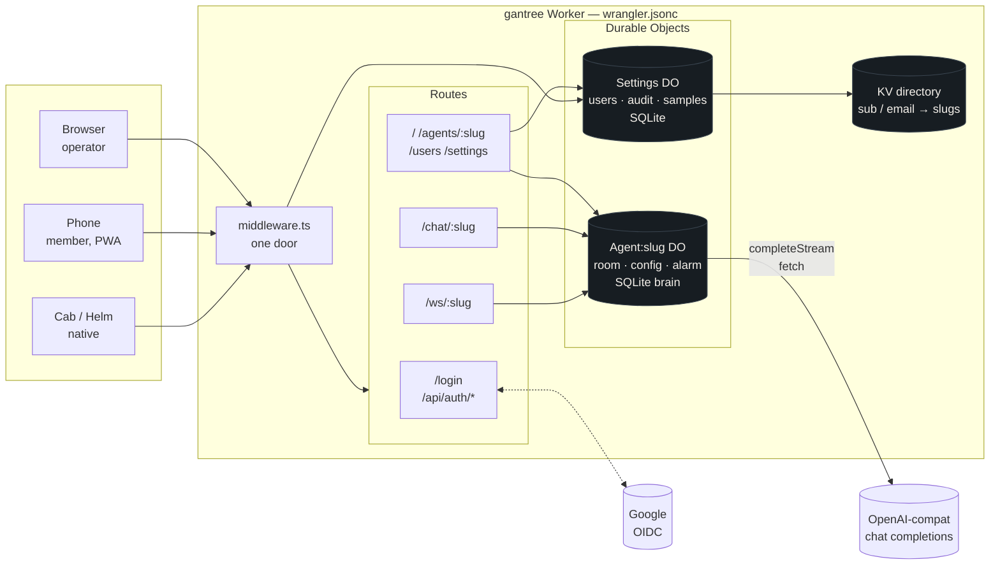

The twelve tools are in-process modules under `brain/plugins`, not
child processes: `chat`, `feeds`, `flights`, `garmin`, `google`,
`google-health`, `image`, `maps`, `math`, `rentals`, `strava`,
`twitter`. The model sees `{plugin}__{tool}` (`google__calendar_list_events`).
Schemas stay off until `mcp_enable`; a brief hold drops after 6 hours
idle, a short hold after 27. Plugin tools take a set and return a list
(`.cursor/rules/brain-plugins-plural.mdc`). `GARMIN_TOOL_TIER`
(`core`, `extended`, `complete`; empty stays `core`) and
`GOOGLE_TOOL_PRESET` (`lean`, `everyday`, `all`; empty stays
`everyday`) narrow those two catalogs. A plugin that cannot serve is
skipped, not spawned: `no_key`, `no_oauth`, `disabled`, or `error`,
on the `status` frame.

Cron, watches, and memory consolidation share the Agent DO alarm.
`nextAlarm()` is the soonest due instant; `alarm()` calls
`brain.alarm()`, which runs due work and returns the next wake. Cost
between fires is zero. The alarm does not start a container.

The brain emits the frames the crane socket used to emit. Phone-facing
kinds are `reply`, `draft`, `typing`, `react`, `cmds`, `aims`, `todo`,
`allow`, and `push`. `status`, `perf`, and `log` stay on the DO. A
phone cannot tell which runtime answered.

Persona and `SELF.md` are SQLite rows: `persona_file` and `selfnote`.
The first native open copies `config.persona` into `PERSONA.md` once,
and only when the table is empty. After that the row is the text.
Operators edit them on the dashboard folds and at
`GET` / `PUT` / `DELETE /api/agents/:slug/persona` and
`GET` / `PUT /api/agents/:slug/self`. Those routes answer 409
`container runtime` while the flag is still `container`.

OAuth for a plugin finishes at `GET /api/auth/catch?state&code`.
`state` is an `oauth-catch` JWE holding `{ slug, plugin }`. The Worker
calls `authFinish` on that agent's DO. The path is public. Detail:
[auth.md](auth.md).

Two deploy targets, same Worker:

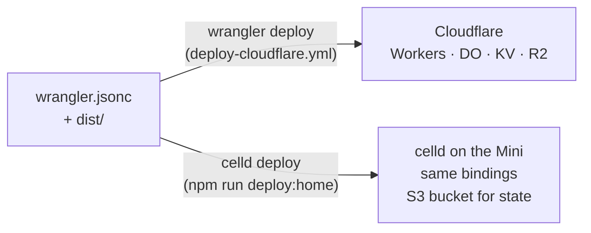

The manifest still declares the Harness container binding. That
binding is the legacy path in [§13](#13-legacy-container-runtime). A
native agent does not start it. On Cloudflare the Worker runs on
Cloudflare's platform. At home **celld** runs that same platform.
Docker or Podman appears only as the engine under celld's container
binding, and only for an agent still on `container`.

| | Cloudflare | Home |
| --- | --- | --- |
| Worker, DOs, KV, R2 | Cloudflare | celld (SQLite + your S3 bucket) |
| Native brain | Agent Durable Object | the same class under celld |
| Harness container (legacy) | Cloudflare Containers | celld container binding |
| What you type | `wrangler deploy` | `celld deploy` |

The brain is TypeScript because the isolate is JavaScript, the Durable
Object class is JavaScript, and a turn is waiting on the model and on
`fetch`. Why Go-in-WASM lost, and why the morning's container lease
was cancelled, is [brain.md](brain.md). The Go tree stays in `harness/`
until cutover, frozen: the spec for agents still on `container`, then
archived.

Behavioral eval is Vitest: `brain/eval`, `npm run eval`. Setup:
[eval_setup.md](eval_setup.md).

## 2. Request path — the door

Every non-public request passes `lib/door/gate.ts`. It is pure:
request + env + store in, decision out. `lib/door/http.ts` turns the
decision into a `Response`; `middleware.ts` is one line.

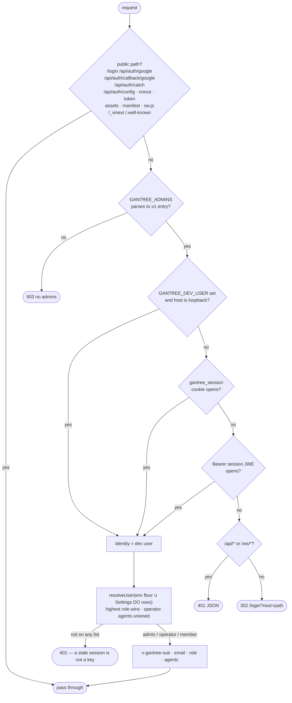

A cookie that opens wins; otherwise `Authorization: Bearer` is the
same session JWE. A bearer on `/api/chat/{avatar,backdrop,theme}` is
the room token (`isAgentRoomRequest`) and is let through before either
of those reads. `/api/auth/catch` is public: the provider redirects
there with no session.

Role, every request, never from the cookie:

| Source | Role | Locked |
| --- | --- | --- |
| `GANTREE_ADMINS` (env) | admin | yes — settings cannot remove |
| `GANTREE_ALLOW` (env) | member | yes |
| Settings DO `users` rows | admin / operator(agents) / member | no |

## 3. Sign-in — Google, PKCE, two cookies

Every miss (`expired`, `state`, `exchange`, `token`, `not_allowed`)
bounces to `/login?error=` and never sets a session. The only identity
a stranger ever sees is their own.

## 4. Chat — phone to the brain through the Agent DO

The Agent DO is the room. A phone joins with the session — the cookie,
or the same JWE on `Authorization` — plus that agent's own list. On a
native agent there is no second socket. The DO hands `inbound` and
`react` to `brain.handleInbound` and fans the frames the brain emits
the same way it fans a crane frame. A container agent still dials in;
that sequence is [§13](#13-legacy-container-runtime).

Native sign-in ([access.md](access.md#phones-native-sign-in)):

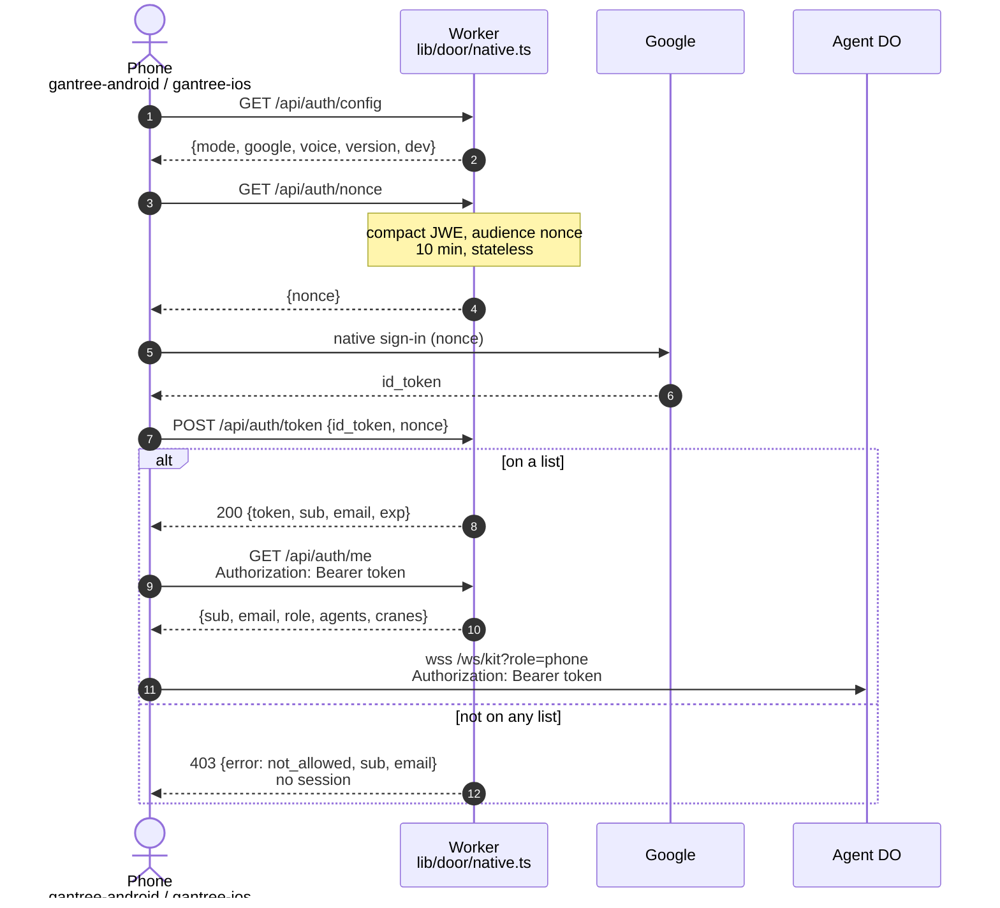

The PWA sends the cookie. On a native agent the turn never leaves the
DO:

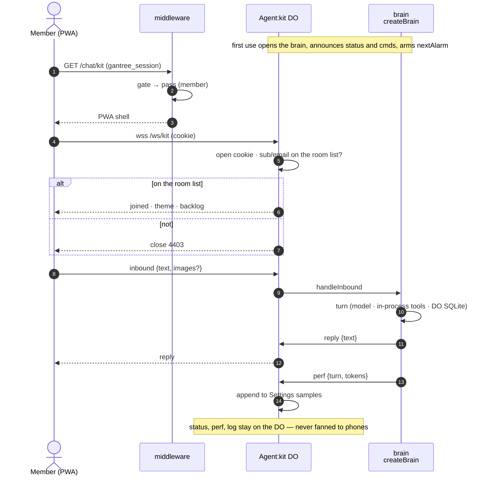

## 5. Agent lifecycle — the DO is the brain

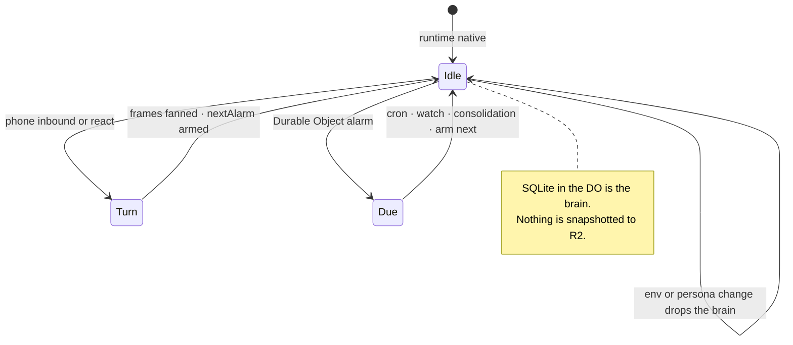

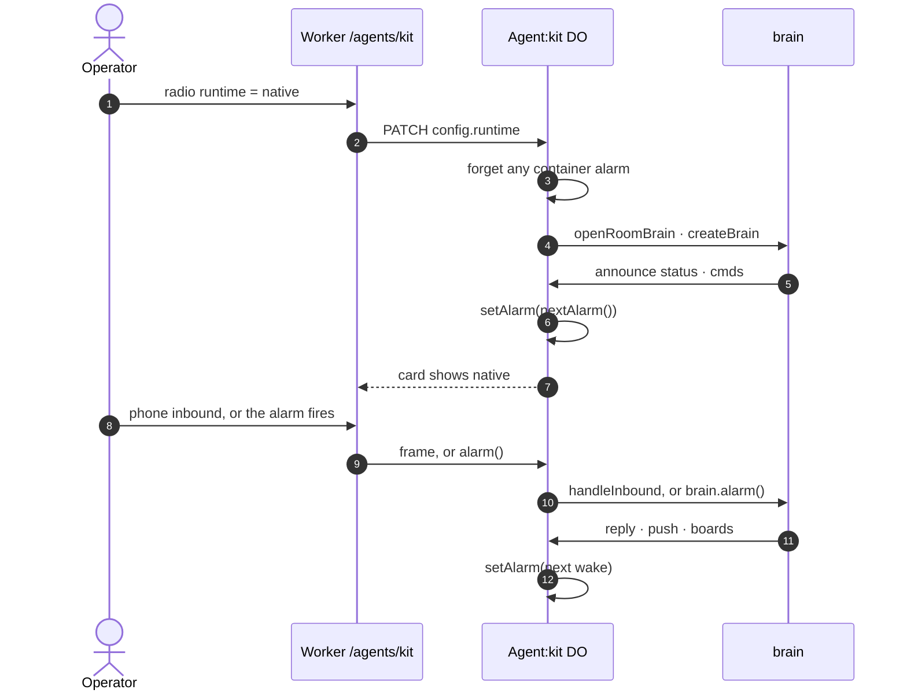

Flipping the radio back to `container` drops the brain and deletes the
alarm. Start, stop, and recreate are the container buttons; on a
native agent the status fold does not show them, and
`POST /api/agents/:slug/container` returns `lastError: "native runtime"`.

## 6. Users — one list, three roles

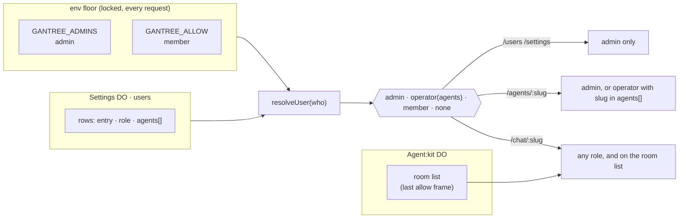

Seeding, by place:

| Where | `GANTREE_ADMINS` / `GANTREE_ALLOW` / `GOOGLE_CLIENT_ID` | `GOOGLE_CLIENT_SECRET` / `SESSION_SECRET` |
| --- | --- | --- |
| Local | `.dev.vars` | `.dev.vars` |
| Cloudflare | Actions **variables** → `wrangler deploy --var` | Actions **secrets** → `wrangler secret bulk` |
| Home | `CELLD_VARS_FILE` | `CELLD_VARS_FILE` |

## 7. Build and ship

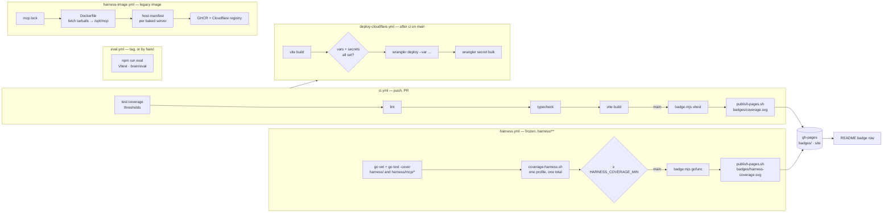

`publish-pages.sh` replaces only the paths it is handed; the writers
share one concurrency group. `harness.yml` keeps running while
`harness/` is in the tree; the number is frozen with that tree, not a
second product. Home deploy is a human running `npm run deploy:home`;
GitHub cannot reach the Mini. Live eval setup is
[eval_setup.md](eval_setup.md).

## 8. Code map

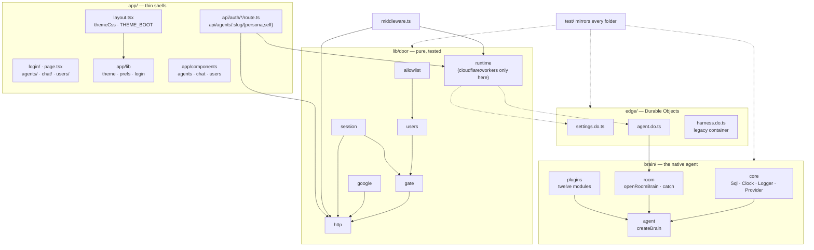

The coverage badge counts `lib/**`, `edge/**`, `app/lib/**`. Brain
suites live under `test/brain/` and run with `npm test`; they are not
in that badge's include. `lib/door/runtime.ts` is the one excluded
file: it imports `cloudflare:workers` and has nothing to assert.

## 9. Why this shape

**One Worker, not three repos.** The originals were a Node console on
the Docker host, a Worker for the phone, and a Go harness in a
container — three ideas of a person and three READMEs. Here settings
and chat are one Vinext app on Workers, and state is Durable Objects
instead of files on a host.

**Why the brain is the Agent DO.** A native agent is always available
and is not billed while idle. The DO wakes in milliseconds, costs
nothing between alarms, and keeps SQLite that outlives the invocation.
The loop, the plugins, and the clock run in that object. Phones see
the same frames either runtime emits. The record is
[brain.md](brain.md).

**Why Durable Objects, not D1.** One actor per agent is the natural
unit: its config, its room, its bearer, its alarm, and — on `native` —
its brain. Settings is one more actor. Nothing is shared except the KV
directory. R2 holds the legacy snapshot set, not the native brain.

## 10. Choices that stay true

If a task fails one of these, it is later, or it is wrong.

1. **One door.** Google signs you in; one list says whether; a role
   says what; each agent's room list says who it talks to. Role is
   computed every request, never read from the cookie. No second
   login. [access.md](access.md).
2. **The Agent DO is truth.** `config.env`, the runtime flag, the room
   list, and the bearer live on the DO. On `native`, persona rows,
   `SELF.md`, sessions, memory, cron, watches, and OAuth tokens live
   in that DO's SQLite. Settings edits them through the DO. No file on
   a host, no second inventory.
3. **The brain does not listen.** A native turn is a method call inside
   the DO. Frames go out through the fan-out the crane socket already
   used. No `/metrics` port, no scrape, no hook. `status`, `perf`, and
   `log` stay on the DO. A container agent is still outbound-only; that
   socket is [§13](#13-legacy-container-runtime).
4. **One mutation path.** Route handlers call `lib/door` and the DO
   stubs. Never storage from a React Server Component. Pages stay thin
   shells.
5. **One manifest, two targets.** Anything that deploys to Cloudflare
   deploys under celld. celld stops on a key it does not model; that
   is the check.
6. **TypeScript is the product.** The Worker, the DO, and the brain are
   one language. Go in `harness/` and `harness/mcp/*` is frozen until
   the last agent leaves `container`, then archived. No `gantree` CLI
   until `npm` scripts are genuinely not enough.
7. **Isolation.** One human list per agent, one DO. A container agent
   also has one Harness DO and one R2 prefix. Retire a tryout = delete
   its DO and, if it snapshotted, its prefix. Adding a person to Kit
   does not touch Ada.
8. **Env change retargets.** On `native`, a changed env or persona
   drops the memoised brain and opens a new one. On `container`, env
   drift is still a recreate. Restart that keeps a ghost allowlist is
   the thing the UI nags.
9. **Not chat.** Settings never sits in a chat turn. Chat is a PWA on
   the same origin, not a feature of the settings screens.
10. **Plugins are modules.** The twelve live under `brain/plugins` and
    load with the Worker. `ready()` publishes or skips. `config.mcp`
    is the grant list the container harness still reads; the native
    registry does not consult it. Per-session schemas are `mcp_enable`.
    [mcp.md](mcp.md), [custom-mcp.md](custom-mcp.md).
11. **Estimates stay estimates.** Spend is `perf` tokens plus an
    optional pasted $/1M. Not an invoice. `unknown` is a first-class
    slice.
12. **Import over write.** `jose` for JWE/JWKS, `openai` for chat
    completions, Vinext for the app, wrangler and celld for deploy. Do
    not invent a Docker client, a JWT parser, or a theme engine.
13. **Coverage is a badge, not a hope.** Two numbers on the README.
    The Vitest floor is `vitest.config.ts`. `HARNESS_COVERAGE_MIN` is
    the frozen Go tree and only goes up while `harness.yml` exists.

## 11. Repo rules

- Tests live under `test/` and mirror the module they cover
  (`lib/door/gate.ts` → `test/door/gate.test.ts`,
  `brain/core/sql.ts` → `test/brain/core/sql.test.ts`). Never beside
  source.
- Import with `@/`. Import leaf modules, not barrels.
- UI folders match screens (`shared`, `agents`, `chat`, `users`,
  `settings`), not widget types. No `src/` wrap, no atoms/molecules.
- `cloudflare:workers` is imported in exactly one place per concern
  (`lib/door/runtime.ts`, `edge/*.do.ts`). Everything else is plain
  TypeScript Vitest can run.
- ESLint + `@stylistic` is the style. No Prettier. Do not disable
  `no-explicit-any`; type it or delete the dead write.
- Nothing new is written with the originals' wire names. `CHAT_*`,
  `CHANNEL=chat`, `agents`, `chat:<slug>:`, plugin `chat` are the
  names ([todo.md](todo_done.md#0-decide)). `PENDANT_*`,
  `CHANNEL=pendant`, `cranes` beside `agents` on `/api/auth/me` are
  accepted as aliases so cab, helm, and agents on the old stack keep
  working until the Phase 4 cutover, then dropped. Marked as aliases
  wherever they appear. Harness-side detail: [channels.md](channels.md),
  [contract.md](contract.md).

## 12. Later, and not the product

**Later** (when a real gap forces it): Workspace `hd` gate; saved
watches and a tile catalog after one attention surface stops being
enough; provider billing pull; the one-shot copy of an existing
`gantry.db` into a native agent's DO SQLite
([brain.md](brain.md#data-migration)); operator writes on boards.
List: [todo.md](todo.md#later).

**Hosted (decided 2026-10-10):** the same Worker sold as a door you
do not deploy — one household per account, every key the customer's,
Settings / Agent DOs named by household instead of by bare slug. Plan
in [todo.md](todo.md#hosted-phase-5--the-paid-door), numbers in
[monetize.md](monetize.md). A native agent has no container line on
that bill.

**Not the product:** Kubernetes, Cloud Run / Lambda, a shared family
brain, pairing the agent through settings, reselling LLM tokens, a
shared Google client for the tools, orgs and invite links beyond one
household per account, a second login, Cloudflare Access in front of
the Worker, anything that makes a turn slower so a dashboard looks
nicer.

## 13. Legacy: container runtime

This section is `runtime: "container"`. It is the default until an
operator flips the radio. The Go harness, the Harness Durable Object,
the crane WebSocket, and the R2 snapshot set stay until cutover, then
they are archived. `edge/harness.do.ts` sets `sleepAfter = "15m"`.
The Agent DO alarm does not start a stopped container: `alarm()`
returns immediately unless the runtime is `native`. Start and Recreate
are the operator buttons. The gap is the morning's record,
[runtime.md](runtime.md).

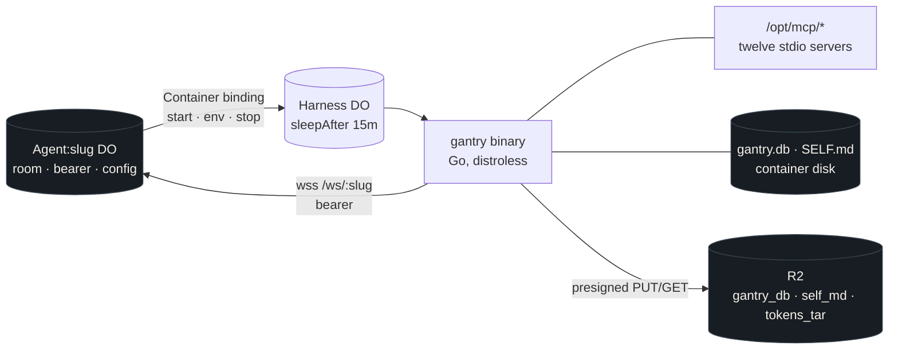

A phone message for a container agent is queued to the crane tag. The
harness dials `/ws/:slug` with the room bearer. The first frame in is
`config` (env, `mcp`, persona, presigned restore and put). The harness
restores `gantry.db` and `self_md` from R2, or starts empty on a 404,
then sends `allow`, `status`, and later `reply` / `draft` / `perf` /
`log` / `snapshot`. `status`, `perf`, `log`, and `snapshot` stay on the
DO. Chat frames fan out to phones the same way a native frame does.

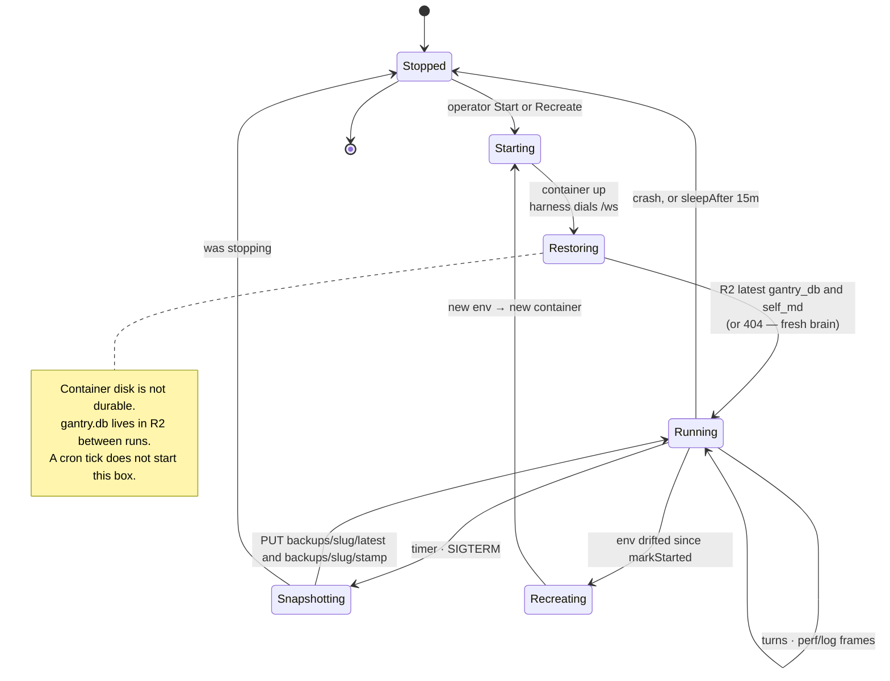

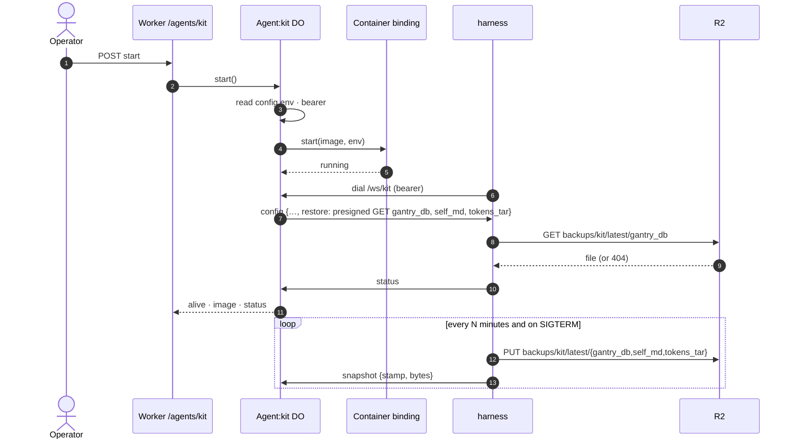

Why this stayed Go, for as long as the flag points here: the turn loop
was already proven in Go — parallel tool calls in one batch, the
Completer round discipline — and both supervisors run a static binary
in a distroless image. That is not the native brain. Workers cannot
host the process, the `exec.Command` MCP host, or `modernc.org/sqlite`.
The port is the TypeScript tree. `harness.yml` still publishes the Go
coverage badge. Workers Paid is required to deploy and run this
container; a native agent does not incur it. Numbers:
[monetize.md](monetize.md).
