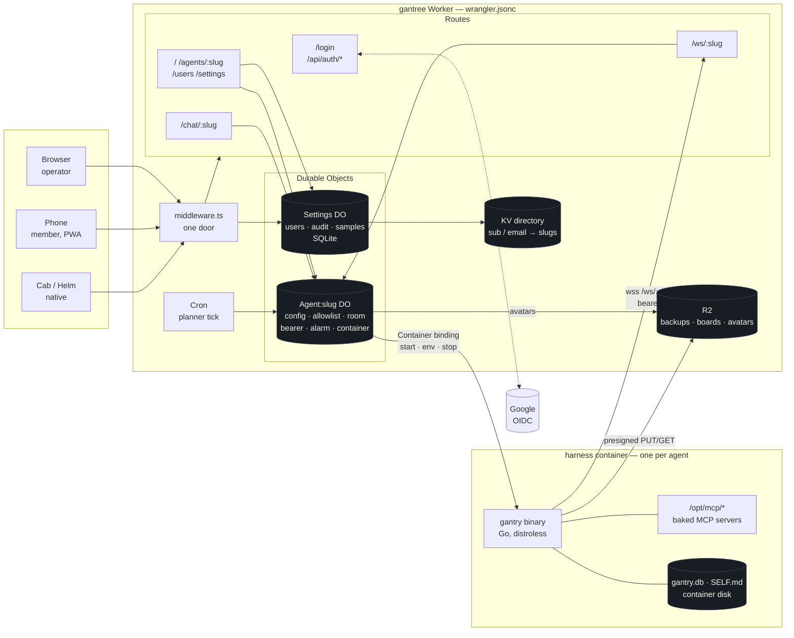
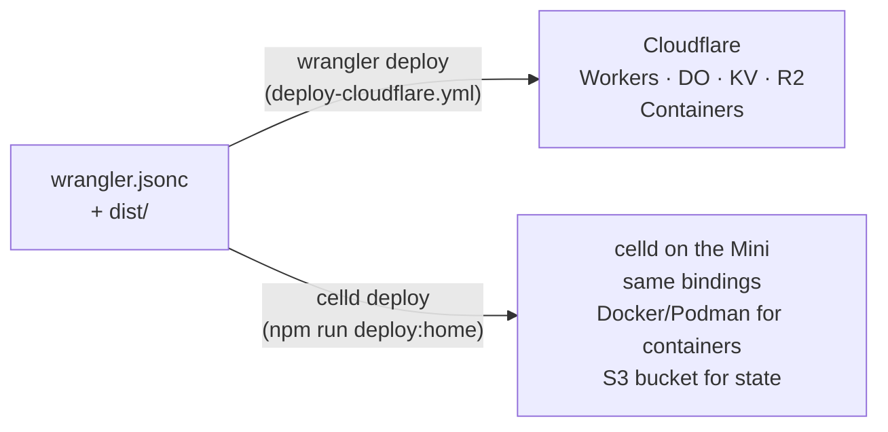
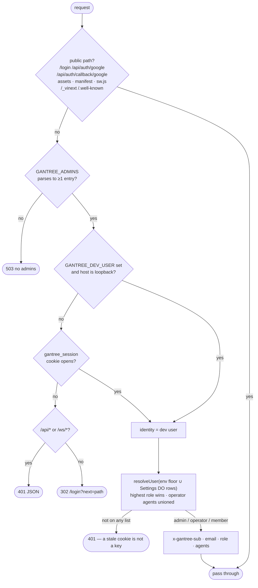
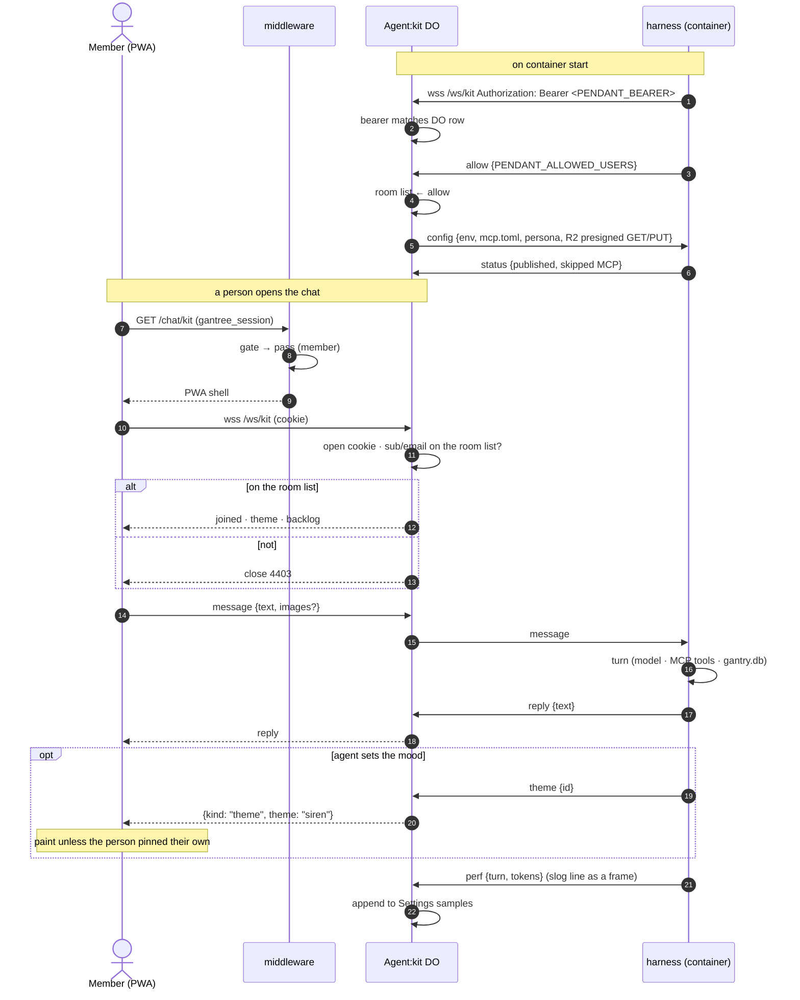
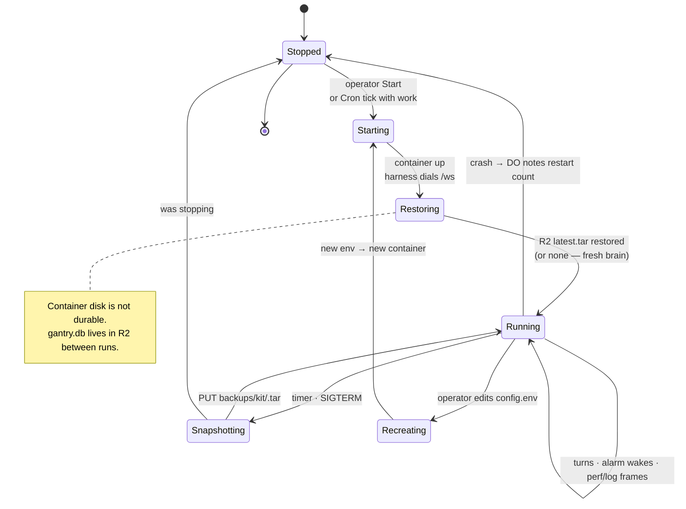
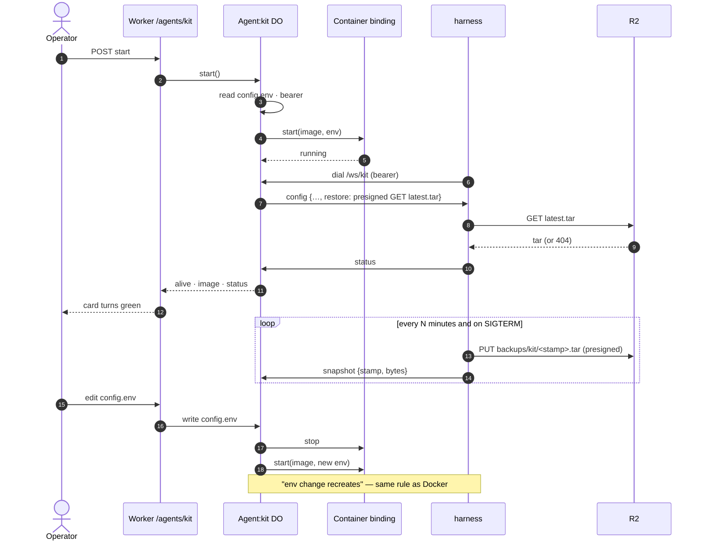
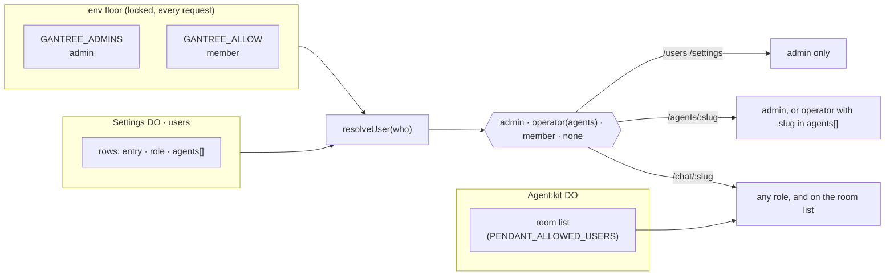
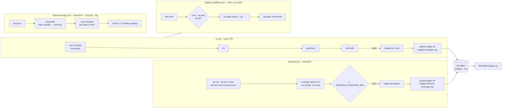
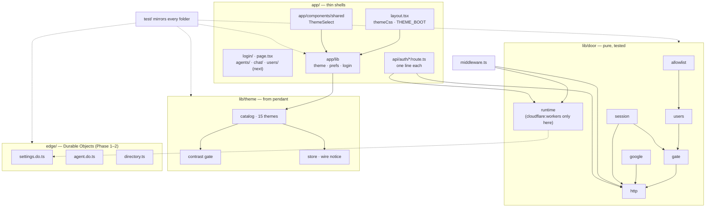

# Architecture

How gantree is put together: the pictures, then the choices that stay
true as it grows. The reasoning behind each shape is in
[proposal.md](proposal.md); who may do what is in [access.md](access.md);
where it runs is in [install.md](install.md). When this file and the
proposal disagree, fix both.

Vocabulary: **settings** (what operators see), **chat** (the PWA a
member talks through), **agents** (one Durable Object + one container
each), **harness** (the Go binary that is the agent), **users** (one
list, three roles). Wire names from the originals (`PENDANT_*`,
`CHANNEL=pendant`) survive until Phase 4 and are marked where they
appear.

## 1. The product

One Worker, one manifest, two places it runs.

Two deploy targets, same picture:

Where Docker went. The originals *operated* Docker: compose files,
`docker.sock`, bind mounts, `docker logs`. None of that exists here on
either target. On Cloudflare the Worker runs on Cloudflare's platform
and the harness on **Cloudflare Containers**. At home **celld** runs
that same platform, and for its container binding it drives Docker or
Podman underneath — an engine you install once and never address. One
OCI image, two supervisors; Docker survives only as celld's engine.

| | Cloudflare | Home |
| --- | --- | --- |
| Worker, DOs, KV, R2, Cron | Cloudflare | celld (SQLite + your S3 bucket) |
| Harness container supervisor | Cloudflare Containers | celld container binding |
| Container engine | Cloudflare's | Docker or Podman, under celld |
| What you type | `wrangler deploy` | `celld deploy` |

Why the languages stay where they are: the harness is Go because the
turn loop — parallel tool calls in one batch, the Completer round
discipline, RSS under small models — is the thing already proven, and
both supervisors run a static Go binary in a distroless image as well
as anything can be run. Rust would buy no user-visible speed (the token
path is the model) and would cost the sixteen Go plugins their shared
SDK. The Worker is TypeScript because Workers execute JS/Wasm, Vinext
and Durable Object classes are JS, and the backend is thin on purpose:
gate, DO storage, socket fan-out. There is no hot loop in it to move.

## 2. Request path — the door

Every non-public request passes `lib/door/gate.ts`. It is pure:
request + env + store in, decision out. `lib/door/http.ts` turns the
decision into a `Response`; `middleware.ts` is one line.

Role, every request, never from the cookie:

| Source | Role | Locked |
| --- | --- | --- |
| `GANTREE_ADMINS` (env) | admin | yes — settings cannot remove |
| `GANTREE_ALLOW` (env) | member | yes |
| Settings DO `users` rows | admin / operator(agents) / member | no |

## 3. Sign-in — Google, PKCE, two cookies

Every miss (`expired`, `state`, `exchange`, `token`, `not_allowed`)
bounces to `/login?error=` and never sets a session. The only identity
a stranger ever sees is their own.

## 4. Chat — phone to harness through the Agent DO

The Agent DO is the room. A phone joins with a cookie plus that agent's
own list; the harness joins with a bearer. Neither side knows the
other's address.

## 5. Agent lifecycle — the DO supervises the container

## 6. Users — one list, three roles

Seeding, by place:

| Where | `GANTREE_ADMINS` / `GANTREE_ALLOW` / `GOOGLE_CLIENT_ID` | `GOOGLE_CLIENT_SECRET` / `SESSION_SECRET` |
| --- | --- | --- |
| Local | `.dev.vars` | `.dev.vars` |
| Cloudflare | Actions **variables** → `wrangler deploy --var` | Actions **secrets** → `wrangler secret bulk` |
| Home | `CELLD_VARS_FILE` | `CELLD_VARS_FILE` |

## 7. Build and ship

`publish-pages.sh` replaces only the paths it is handed; the three
writers share one concurrency group. Home deploy is a human running
`npm run deploy:home`; GitHub cannot reach the Mini.

## 8. Code map

Coverage counts `lib/**`, `edge/**`, `app/lib/**`. `lib/door/runtime.ts`
is the one excluded file: it imports `cloudflare:workers` and has
nothing to assert.

---

## 9. Why this shape

**One Worker, not three repos.** The originals were a Node console on
the Docker host, a Worker for the phone, and a Go harness in a
container — three ideas of a person and three READMEs. Here settings
and chat are one Vinext app on Workers, state is Durable Objects
instead of files on a host, and the harness is a container the Agent
DO supervises. Cloudflare Containers in the cloud; celld's container
binding at home.

**Why the harness stays Go, in a container.** The loop that was
hardened on small models — parallel tool calls, Completer rounds, RSS
discipline — is Go and stays Go. It does not become a Worker. The DO
starts it, passes its env, wakes it on alarm, and is the room it dials.

**Why Durable Objects, not D1.** One actor per agent is the natural
unit: its config, its room, its bearer, its alarm, its container
handle. Settings is one more actor. Nothing is shared except the KV
directory and R2.

**Why a brain in R2.** Container disk is not durable on either target.
`gantry.db` + `SELF.md` snapshot to R2 on a timer and on stop, restore
on start, via presigned URLs on the `config` frame. The harness's
storage code does not change.

## 10. Choices that stay true

If a task fails one of these, it is later, or it is wrong.

1. **One door.** Google signs you in; one list says whether; a role
   says what; each agent's room list says who it talks to. Role is
   computed every request, never read from the cookie. No second
   login. [access.md](access.md).
2. **The Agent DO is truth.** `config.env`, `config.mcp`, persona,
   allowlist, bearer live on the DO. Settings edits them; the harness
   reads them at boot. No file on a host, no second inventory.
3. **Pull, don't punch.** The harness is outbound-only. No `/metrics`
   port, no scrape, no hook. `status`, `perf`, `log`, `allow`,
   `snapshot` ride the socket it already opened. If a settings want
   would make the harness slower, the want is wrong.
4. **One mutation path.** Route handlers call `lib/door` and the DO
   stubs. Never storage from a React Server Component. Pages stay thin
   shells.
5. **One manifest, two targets.** Anything that deploys to Cloudflare
   deploys under celld. celld stops on a key it does not model; that
   is the check.
6. **One language in this repo, two in the product.** TypeScript here.
   Go in `harness/` and `harness/mcp/*`. No `gantree` CLI until `npm`
   scripts are genuinely not enough — still TypeScript.
7. **Isolation.** One human list per agent, one DO, one container, one
   R2 prefix. Retire a tryout = delete its DO and prefix. Adding a
   person to Kit does not touch Ada.
8. **Env change recreates.** Same rule as Docker. Restart keeps a
   ghost allowlist; the UI nags.
9. **Not chat.** Settings never sits in a chat turn. Chat is a PWA on
   the same origin, not a feature of the settings screens.
10. **MCP is baked in.** `harness/mcp.lock` → image. Omit a server from
    an agent's `config.mcp` and it does not exist for that agent. No
    download at agent start. [custom-mcp.md](custom-mcp.md).
11. **Estimates stay estimates.** Spend is `perf` tokens plus an
    optional pasted $/1M. Not an invoice. `unknown` is a first-class
    slice.
12. **Import over write.** `jose` for JWE/JWKS, Vinext for the app,
    wrangler and celld for deploy. Do not invent a Docker client, a
    JWT parser, or a theme engine.
13. **Coverage is a badge, not a hope.** Two numbers on the README.
    Thresholds in `vitest.config.ts` and `HARNESS_COVERAGE_MIN` only
    go up.

## 11. Repo rules

- Tests live under `test/` and mirror the module they cover
  (`lib/door/gate.ts` → `test/door/gate.test.ts`,
  `app/components/shared/ThemeSelect.tsx` →
  `test/app/components/shared/ThemeSelect.test.tsx`). Never beside
  source.
- Import with `@/`. Import leaf modules, not barrels.
- UI folders match screens (`shared`, `agents`, `chat`, `users`,
  `settings`), not widget types. No `src/` wrap, no atoms/molecules.
- `cloudflare:workers` is imported in exactly one place per concern
  (`lib/door/runtime.ts`, later `edge/*.do.ts`). Everything else is
  plain TypeScript Vitest can run.
- ESLint + `@stylistic` is the style. No Prettier. Do not disable
  `no-explicit-any`; type it or delete the dead write.
- Wire names from the originals (`PENDANT_*`, `CHANNEL=pendant`,
  `cranes` on `/api/auth/me`, `pendant:<slug>:`) stay until
  Phase 4 so cab, helm, and agents on the old stack keep working.
  They are marked as wire names wherever they appear.

## 12. Later, and not the product

**Later** (when a real gap forces it): Workspace `hd` gate; saved
watches and a tile catalog after one attention surface stops being
enough; provider billing pull; harness write-through to DO SQLite;
operator writes on boards. List: [todo.md](todo.md#later).

**Not the product:** hosted SaaS, Kubernetes, Cloud Run / Lambda, a
shared family brain, pairing the agent through settings, multi-tenant
orgs, invite links, billing, a second login, Cloudflare Access in
front of the Worker, anything that makes the harness slower so a
dashboard looks nicer.
