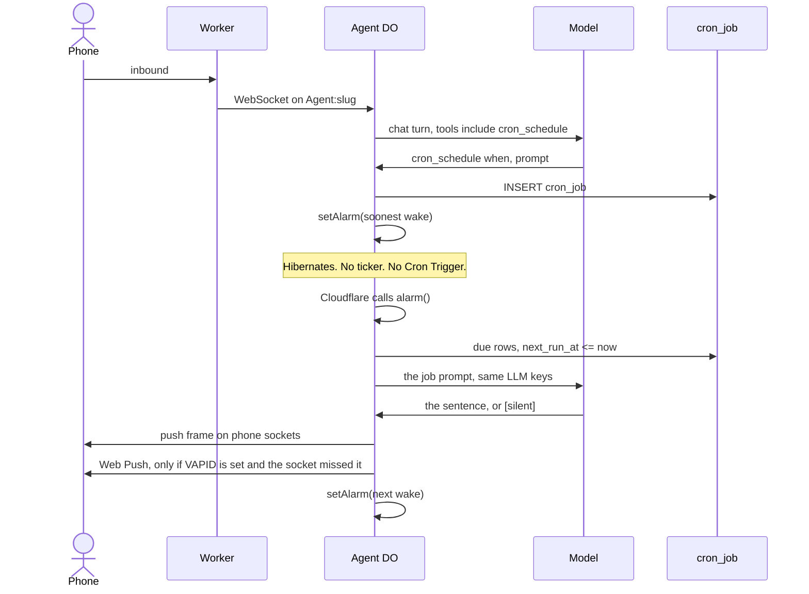
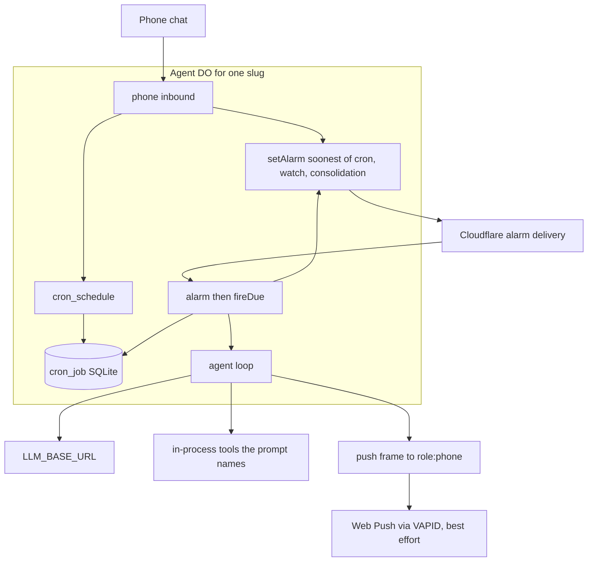

# Cron architecture

Where a reminder lives in this deploy, and what wakes it. Job kinds,
`when` / `repeat`, and the planner prompt are in [cron.md](cron.md).
The room lifecycle is [architecture.md](architecture.md) §5.

A reminder is a row in the Agent Durable Object's SQLite. Cloudflare
wakes that one object with a Durable Object alarm. The Worker does not
register a Cron Trigger, and the agent does not call a Cloudflare cron
API. A sentence in chat is not a job. The job exists when `cron_schedule`
returns `scheduled id=…`, which is the insert into `cron_job`.

`wrangler.jsonc` binds `AGENT` and `SETTINGS`. It has no
`triggers.crons`. The Cron Triggers page for this Worker stays empty.
That page is a different product: a schedule on the Worker that invokes
`scheduled()`. This runtime never implements `scheduled()`.

## Nothing is sent to Cloudflare

This is the part that looks like a gap and is not. There is no outbound
registration step. The only Cloudflare surface the cron touches is one
method on the object's own storage:

```ts
// edge/agent.do.ts, armAlarm
await this.ctx.storage.setAlarm(at);
```

`ctx.storage.setAlarm` writes the wake time next to the object's SQLite.
It survives hibernation and eviction. It does not appear in the
dashboard, in `wrangler deployments`, or in the Cron Triggers list. The
only way to see it is to ask the object: `cron_list` in chat prints the
rows the alarm is armed for.

When the time passes, the runtime instantiates `Agent` for that
`idFromName(slug)` and calls its `alarm()` method. That call is the
whole wake. No request, no WebSocket, no Worker `fetch`.

## Where the row is

One Agent object per inventory slug, `idFromName(slug)`
(`lib/chat/location.ts`). Its SQLite is `ctx.storage.sql`. The harness
opens that as the cron store and migrates `cron_job`
(`harness/cron/store.ts`).

| Column | What it holds |
| --- | --- |
| `prompt` | What the wake should say or do |
| `kind` | `once`, `daily`, `every`, `daily_planner`, `examples`, … |
| `expr` | Clock (`16:00`), RFC3339, or an interval |
| `timezone` | IANA zone used to compute `next_run_at` |
| `next_run_at` | Next fire, UTC text `YYYY-MM-DDTHH:MM:SS.nnnnnnnnnZ`, so `<=` is a string compare |
| `enabled` / `running` | Live row, and a claim so two alarms cannot run it twice |
| `session_id` | The room. New rows use the agent slug |
| `user_id` | Stored as `''` on insert. Delivery does not use a per-user cron destination |
| `memory_id` / `memory_subject` | Optional pin. The wake loads that memory row as `[job memory]` |

The insert happens inside the chat turn, in the same object that is
already answering. `cron_schedule` (`harness/cron/tools.ts`) parses
`when`, then `INSERT`s. No outbound call to Cloudflare is part of that
insert.

Two rows are inserted without the model asking. On every fresh open of
the harness, `planner.ensureFor` writes one `daily_planner` job (default
07:10, unless `/planner off`), and `examples.ensureFor` writes the
examples spreader unless `EXAMPLES_QTY` is empty or `0`. A 4pm shower
reminder is neither of those. It appears only after `cron_schedule`.

## How it should work, end to end

Each step names the function that owns it. If a reminder does not
arrive, one of these steps did not happen; the next section says how to
find which.

1. **Phone sends a turn.** The phone's WebSocket frame lands in
   `Agent.webSocketMessage` → `dispatchSocket` (`edge/agent.do.ts`). A
   phone `inbound` is a native turn: it is not fanned to a crane socket,
   it goes to `handToBrain`.

2. **The harness is opened in-process.** `handToBrain` → `nativeBrain`
   → `openRoomBrain` (`harness/room/index.ts`) → `createBrain`
   (`harness/agent/brain.ts`). `createBrain` opens the cron store on
   `ctx.storage.sql`, runs `planner.ensureFor` and `examples.ensureFor`,
   and calls `runner.boot()`. After that boot, `onClock(nextWake())` arms
   the clock, and on a fresh open `nativeBrain` arms it again with
   `harness.nextAlarm()`.

3. **The model sees `cron_schedule`.** The three cron tools are builtins
   in the `Registry` (`brain.ts`, `cronTools.toCoreTools(delivery)`).
   Builtins have no `server__` prefix, so `alwaysOn` in
   `harness/tools/enable.ts` publishes them on every turn. They do not
   need `mcp_enable`. They are omitted when `CRON_ENABLED` is `0`,
   `false`, or `off`. `turn.noTools` hides them, which only happens for
   `examples_ping` wakes.

4. **The model calls it and the row is inserted.** `CronTools.schedule`
   requires `delivery.sessionId`, parses `when` in the persona zone
   (falling back to `CRON_TZ`, then `America/Los_Angeles`), and calls
   `Store.schedule`. The tool result is `scheduled id=… next_run=…`. If
   the model answers "set" without that line, there is no row.

5. **The turn finishes, then the alarm is armed.** `handleInbound` runs
   the turn through `enqueue`, which resolves only when the model loop
   has returned. Its `finally` calls `onClock(nextWake())`. The DO
   passes `armAlarm` as that callback, so a new caller of
   `handleInbound` still arms the clock. `handToBrain` also calls
   `armAlarm(harness.nextAlarm())` after the turn. `armAlarm` is
   serialized, so the later write wins. `nextWake()` is the earliest of
   `cronStore.nextDue()` (omitted when cron is off), `watch.nextDue()`,
   and the next consolidation. Times under one second out are floored
   to `now + ALARM_MIN_LEAD_MS`. `null` deletes the alarm.

6. **Cloudflare calls `alarm()`.** The object may have hibernated or
   been evicted. `alarm()` reopens the harness (`nativeBrain`) and calls
   `harness.alarm(emit)`, which runs `runner.fireDue(now, onCron)`, then
   due watches, then a consolidation pass when
   `MEMORY_CONSOLIDATE_MINUTES` says so.

7. **`fireDue` claims and runs the row.** It first clears every
   `running = 1` row. A Durable Object runs one `alarm()` at a time and
   only that handler calls `fireDue`, so a set flag is a claim left by
   a crashed wake, not a live job. `Store.due` then selects
   `enabled = 1 AND running = 0 AND next_run_at <= now`. `Store.claim`
   sets `running = 1`. It reads the claim back as `changes() > 0`,
   because Durable Object SQLite counts the `idx_cron_due` index row in
   `rowsWritten`, so a successful claim reports 2, never 1. The runner
   builds the job prompt (prefix, optional
   `[job memory]`, the stored prompt) and calls `onCron`, which is the
   same `execute` loop a chat turn uses: same model, same tools, same
   persona. Skipped entirely when cron is off.

8. **The reply is pushed, or not.** `[silent]` or an empty reply stores
   the turn and pushes nothing. Anything else goes out as a `push`
   frame through `emit` → `enqueueCrane` → `dispatchSocket`, which fans
   to `role:phone` sockets, persists to the phone queue, and calls
   `notifyOffline` for Web Push when VAPID is set. `Store.finish`
   disables a one-shot or advances a repeating row.

9. **The clock moves forward.** On success `alarm()` deletes the
   `alarm-fail` counter and calls `armAlarm(next)`, where `next` is
   `nextWake()` recomputed after the fire. It does not call `onClock`.
   That callback would race the failure path.

   If `nativeBrain()` or the wake throws, the error is logged and not
   rethrown. A thrown alarm is retried at most six times and then
   deleted, which would drop the clock. The catch stores `alarm-fail`
   (a count on the object) and arms `max(nextAlarm(), now + delay)`.
   The delay starts at 2 seconds and doubles, capped at 15 minutes.
   The next success deletes the count. If the harness never opened,
   `nextAlarm()` is skipped and the delay alone is armed.



A 4pm row does not have to be the alarm that is armed right now. If
consolidation or a watch is sooner, that alarm rings first, finds no due
cron, and arms whatever is next. The 4pm row stays in `cron_job` until a
later alarm finds `next_run_at` in the past and fires it. One alarm per
object is the whole clock.



The wake uses the same model and the same in-process tools as a chat
turn. Calendar, mail, and Garmin run only when the job prompt tells the
model to call them. They are not called by the alarm itself.

The reply is a `push` frame. `user_id` on the row is empty, so the frame
goes to every phone socket on that agent (`role:phone` in
`lib/chat/route.ts`). If no phone socket is open, `notifyOffline` sends
a Web Push to stored subscriptions. That step returns immediately when
the VAPID keys are unset. The frame is still queued for the next time
the phone connects.

## When the alarm is armed

Exactly these places call `armAlarm`:

| Caller | When |
| --- | --- |
| `onClock` after `runner.boot` | Fresh open, after crashed claims are cleared |
| `onClock` from `handleInbound` | After every inbound, including a slash command that inserts a row |
| `nativeBrain` | First open of the harness in this object instance, including the reopen after a persona or config save (`reloadNative`, `retargetBrain`) |
| `handToBrain` | After every phone `inbound` or `react` over the WebSocket |
| `alarm()` success | `armAlarm(next)`, and delete `alarm-fail` |
| `alarm()` failure | Backoff arm from `alarm-fail`. The error is not rethrown |

`alarm()` does not use `onClock`. HTTP entry points that reuse an
already-open brain (`selfHttp`, auth finish) do not insert cron rows.
A row inserted by any new path is armed if that path goes through
`handleInbound` or a fresh `createBrain`.

Consolidation does not keep an idle object awake. The last pass time
is `memory_consolidate.last_at`, so an eviction does not look like a
first run. After a pass, if no episode is waiting, `consolidateAt`
returns null. The first pass (no row yet) is
`now + MEMORY_CONSOLIDATE_MINUTES`, so a sooner cron can own the alarm.
A cron row is armed by `onClock`, not by a 30-minute sweep.

## Keys and permissions

Scheduling does not ask Cloudflare for a new permission. The deploy
already has the `AGENT` binding. `setAlarm` is a method on that object.
There is no cron API token, no `cron:write` scope, and nothing to add
under Cron Triggers.

| Name | Where it is read | What it does for a cron |
| --- | --- | --- |
| `LLM_BASE_URL`, `LLM_API_KEY`, `LLM_MODEL` | Agent `config.env`, or the house Worker secret when the agent left it blank | The wake turn. The insert does not call the model host. The fire does. |
| `CRON_TZ` | Agent `config.env` | Zone for a clock `when`, if the persona has no Timezone. Unset means `America/Los_Angeles`. A Worker secret of the same name is not a house key, so it does not fall through. |
| Persona Timezone | `PERSONA.md` | Wins over `CRON_TZ`. |
| `DAILY_PLANNER_AT` | Agent `config.env` | Clock for the boot-installed planner. Default `07:10`. |
| `EXAMPLES_QTY` | Agent `config.env` | Boot-installed example pings. Empty or `0` skips that row. |
| `MEMORY_CONSOLIDATE_MINUTES` | Agent `config.env` | How often consolidation wants the single alarm. Default 30. `0` leaves the alarm to cron and watches. |
| `VAPID_PUBLIC_KEY`, `VAPID_PRIVATE_KEY` | Worker env (`this.env` on the DO) | Lock-screen Web Push when the phone socket is closed. Unset means chat-only delivery. |
| `CRON_ENABLED` | Agent `config.env` | Empty or unset is on. `0`, `false`, or `off` skips cron tools, the boot planner and examples rows, `fireDue`, and cron in `nextWake`. Stored rows stay. `/cron` still lists them. |
| `CRON_MAX_JOBS` | Agent `config.env` | Cap on enabled rows. Default 50. A value below 1 falls back to 50. |

Plugin keys (Google, Garmin, maps) matter only if the wake's prompt
calls those tools. They are not required to store or fire a plain
reminder.

## How to tell it was set, and where it broke

Work down this list. Each check isolates one step above.

1. **Is there a row?** Send `/cron`, or ask the agent to run `cron_list`.
   Both print the same lines: enabled rows with `next=` and
   `last_error`. No row with your prompt means step 4 did not happen:
   the model replied "set" without calling the tool. That is a persona
   or prompt problem, not a Cloudflare one. The Cloudflare Cron
   Triggers list will never show these rows.

2. **Does the alarm ring at all?** The daily planner is inserted on
   every fresh open at `DAILY_PLANNER_AT` (07:10). If it never arrives,
   steps 6 to 9 are dead for this object. If it does, the alarm works
   and the problem is your specific row.

3. **Did it fire?** `wrangler tail` around the due time. The runner logs
   `cron job firing`, then one of `cron job pushed`, `cron silent skip`,
   `cron empty reply`, `cron job handle failed`, or `cron push failed`
   (`harness/cron/runner.ts`). `cron silent skip` and `cron empty reply`
   look identical to "did not fire" from the phone: the model chose
   `[silent]`.

4. **Did delivery fail?** After the due time, `cron_list` shows the
   finished row with `last_error`. `push: …` means the fire happened and
   the frame did not go out.

5. **Is the clock in the right zone?** `scheduled … tz=` in the tool
   result shows the zone that was used. A 4pm in the wrong zone is a
   row that fires at the wrong hour, not a missing row.

## Fixed

The holes from the first walk-through. Each one is in the tree now.

- [x] **`alarm()` re-arms when the open fails.** `nativeBrain()` sits
      inside the `try` in `Agent.alarm`. A failure logs, stores
      `alarm-fail`, and arms a backoff. It does not rethrow, so
      Cloudflare's six-retry cap cannot delete the clock.

- [x] **`publishOnce` retries after a rejection.** The rejection clears
      the memoized promise and rethrows, so the next inbound or alarm
      tries `registry.publish()` again.

- [x] **A wake that keeps throwing backs off.** `alarm-fail` lives in
      DO storage. The delay starts at 2 seconds and doubles, capped at
      15 minutes. A success deletes the key.

- [x] **`clearStaleRunning()` stays unconditional on purpose.** One
      `alarm()` runs at a time, and only that path calls `fireDue`, so
      every `running = 1` row at the start is a crashed claim. The
      comments in `harness/cron/store.ts` and `harness/cron/runner.ts`
      say so. There is no time window.

- [x] **The harness rearms when the clock changes.** `onClock` runs
      after `runner.boot` and in `handleInbound`'s `finally`. The DO
      passes `armAlarm`. `alarm()` does not use the callback, so a
      failure can apply the backoff without a second writer racing it.

- [x] **An idle agent does not wake to consolidate.** The last pass is
      `memory_consolidate.last_at`. With no episode waiting,
      `consolidateAt` returns null.

- [x] **`CRON_ENABLED` and `CRON_MAX_JOBS` are read.** The keys table
      above matches [cron.md](cron.md).

- [x] **`/cron` lists the table.** Same text as `cron_list`, and it is
      in the slash catalog, so it does not depend on the model calling
      the tool.

- [x] **`claim()` reads `changes() > 0`.** Durable Object SQLite reports
      index row writes in `rowsWritten`, so the one-row claim UPDATE
      returned 2 and `=== 1` was false. `fireDue` skipped every due job
      and left `running = 1`, which is the `cron cleared stale running
      flags` line on the next open with no `cron job firing` after it.
      Same fix in the watch store and the aims event supersede.
