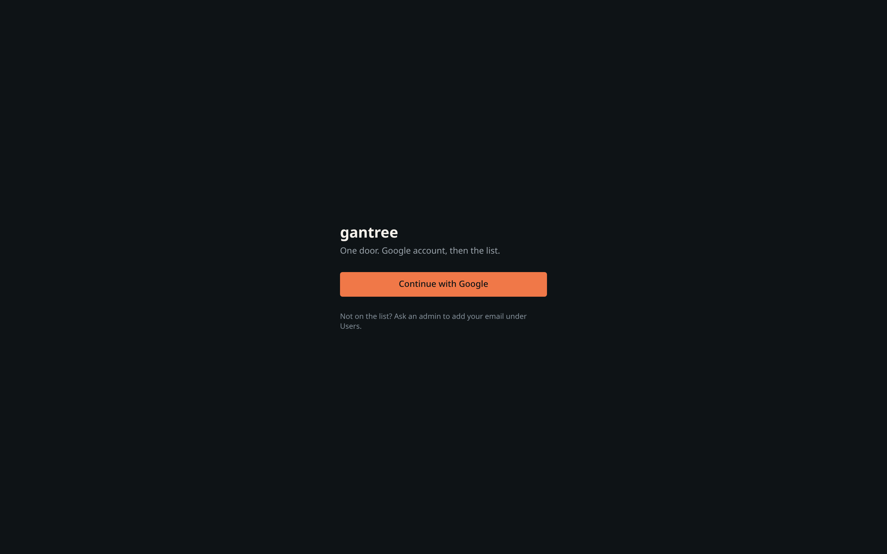

# Install — local, Cloudflare, or home

Same Worker, same `wrangler.jsonc`, three places it runs. The harness is
the Agent Durable Object and opens no listen port. The same Worker is
the Vinext app and serves the HTTP API, including the mailbox at
`/ws/<slug>`.

| Place | Command | State | Reach it at |
| --- | --- | --- | --- |
| Local dev | `npm run dev` | in-memory, `.wrangler/` | `http://127.0.0.1:3000` |
| Cloudflare | `wrangler deploy` (CI) | Workers · DO · KV | `https://gantree2.bldhosting.com` (custom domain in `wrangler.jsonc`; a fork edits `routes` or drops it for `workers.dev`) |
| Home (Mini / NUC / VM) | `npm run deploy:home` (`celld deploy`) | celld | Tailscale HTTPS or a Cloudflare Tunnel |

Need **Node 22** (`node -v`). Distro `apt install npm` is often Node 20
and will fail.

---

## Google OAuth client

gantree does not create this. GCP → **APIs & Services → Credentials →
Create credentials → OAuth client ID**.

| Field | Value |
| --- | --- |
| Application type | **Web application** |
| Authorized redirect URIs | one line per place you run, below |
| Scopes (consent screen) | `openid`, `email`, `profile` — nothing else |

| Place | Redirect URI |
| --- | --- |
| Local dev | `http://127.0.0.1:3000/api/auth/callback/google` (Google accepts loopback `http`) |
| Cloudflare | `https://gantree2.bldhosting.com/api/auth/callback/google` (a fork: its own `routes` host or `workers.dev` origin) |
| Home | `https://<mini>.<tailnet>.ts.net/api/auth/callback/google` or your Tunnel hostname |

**Google rejects private LAN IPs** (`http://192.168.x.x`). A home box
must sit behind Tailscale HTTPS or a Tunnel for sign-in to work. One
client can carry all three redirects.

Consent screen: External (or Internal if Workspace-only). External +
Testing → add yourself as a test user.

---

## Local dev

```bash
git clone https://github.com/shotah/gantree2.git
cd gantree2
cp .dev.vars.example .dev.vars
# .dev.vars: GOOGLE_CLIENT_ID, GOOGLE_CLIENT_SECRET, SESSION_SECRET (≥32 chars),
#            GANTREE_ADMINS=you@example.com
npm ci
npm run dev            # http://127.0.0.1:3000 → /login
```

Sign in. You are admin. A second Google account gets `not_allowed`
until you add it on `/users`.

Without a Google client: `GANTREE_DEV_USER=118212345678901234567:you@example.com`
in `.dev.vars` fakes a session on loopback only. The sub is 10–32 digits.
It still has to be in `GANTREE_ADMINS` or `GANTREE_ALLOW`. Details:
[access.md](access.md#dev-without-google).

`npm run dev` is Vite on `127.0.0.1:3000`. It serves the Durable Objects
and the harness. Screenshots in this repo were taken against `npm run dev`.
`npm run build && npm run start` is the built Worker under Miniflare
(`dist/server/wrangler.json`); use it when you want the production
bundle, not to get Durable Objects.

### Chat with a real agent locally

With house `LLM_BASE_URL`, `LLM_API_KEY`, and `LLM_MODEL` in `.dev.vars`,
run `npm run agent`. It starts Vite (Worker, Durable Objects, native harness)
unless something healthy is already on port 3000, ensures a local agent
(default slug `kit`), and restarts the Agent Durable Object so
`nativeBrain` opens with those house keys and, when agent config leaves them
blank, fills `CHAT_MAILBOX_URL` (`ws(s)://<origin>/ws/<slug>`) and
`CHAT_BEARER` (the room bearer) so `chat__avatar_update` can set the face.
`PUBLIC_ORIGIN` is that origin when it is set. When `IMAGE_OUTPUT_DIR` is
blank, the same harness uses `/images`. Those bytes live in the Agent DO
sqlite table `image_output`, which is the handoff `photo_generate` gives
to `chat__avatar_update` and `chat__backdrop_update`. Chat at
`http://127.0.0.1:3000/chat/kit` (or `--slug ada`). Set
`GANTREE_DEV_USER` and list that identity in `GANTREE_ADMINS` so loopback
API calls can create the agent without a browser session. The script
also puts that user on the agent room, which is what opens the chat
socket. The harness is the Agent Durable Object that deploy ships.

House keys the harness reads from `.dev.vars` (and, in production, from
Worker secrets): `LLM_BASE_URL`, `LLM_API_KEY`, `LLM_MODEL`, and
optionally `SEARCH_API_KEY` and `SEARCH_PROVIDER`. An agent's own `config.env` wins
when the same name is set on both. Other keys live on the agent. Feeds
publish with no key; `FEEDS_USER_AGENT` only overrides the User-Agent,
which defaults to `gantree/<version> (+https://gantree2.bldhosting.com)`.
The Keys fold suggests every row below (search keys are listed once under
`websearch`; the Worker may still set them as house secrets). Register the catch URIs in
[auth.md](auth.md). `CRON_TZ`, `DAILY_PLANNER_AT`,
`MEMORY_CONSOLIDATE_MINUTES`, `DYNAMIC_TOOLS`, `MCP_ENABLE_FORCE`, and
`PUBLIC_ORIGIN` are harness knobs. `PUBLIC_ORIGIN` is the catch host,
with no path.

| Plugin | Key | Required |
| --- | --- | --- |
| house | `LLM_BASE_URL` | yes, house or agent |
| house | `LLM_API_KEY` | yes, house or agent |
| house | `LLM_MODEL` | yes, house or agent |
| feeds | `FEEDS_USER_AGENT` | no |
| websearch | `SEARCH_API_KEY` | yes |
| websearch | `SEARCH_PROVIDER` | no — blank means brave |
| twitter | `X_BEARER_TOKEN` | yes |
| strava | `STRAVA_CLIENT_ID` | yes |
| strava | `STRAVA_CLIENT_SECRET` | yes |
| maps | `GOOGLE_MAPS_API_KEY` | yes |
| flights | `SERPAPI_API_KEY` | yes |
| rentals | `RENTCAST_API_KEY` | yes |
| google-health | `GOOGLE_HEALTH_CLIENT_ID` | yes |
| google-health | `GOOGLE_HEALTH_CLIENT_SECRET` | yes |
| google | `GOOGLE_OAUTH_CLIENT_ID` | yes |
| google | `GOOGLE_OAUTH_CLIENT_SECRET` | yes |
| google | `GOOGLE_TOOL_PRESET` | no — `everyday` (default), `lean`, or `all` |
| garmin | `GARMIN_EMAIL` | yes |
| garmin | `GARMIN_PASSWORD` | yes |
| garmin | `GARMIN_TOOL_TIER` | no — `core` (default), `extended`, or `complete` |

Open `http://127.0.0.1:3000/chat/<agent id>` after you create the agent.
Blank keys on a new agent use the house `LLM_*` from `.dev.vars`. The
browser only ever sees the key names (`GET /api/tools` → `house`).
In production, set them with `wrangler secret put` and new agents need
no keys of their own.

```bash
npm run seed -- --vars   # writes .dev.vars.shot from .dev.vars (placeholder identity)
npm run dev:shot         # the same dev server, reading .dev.vars.shot
npm run seed             # fills Kit and Ada through the HTTP API
npm run shot             # headless Chrome → assets/docs/*.png. CHROME_BIN overrides the Chrome path.
```

Pictures never carry a real account. `npm run seed` derives
`.dev.vars.shot` (git-ignored) from your `.dev.vars`: every secret is
copied, but `GANTREE_DEV_USER` and `GANTREE_ADMINS` become the
placeholder `100000000000000000001:dev@example.com` and `GANTREE_ALLOW`
is emptied. `npm run dev:shot` is `CLOUDFLARE_ENV=shot`, which makes the
Cloudflare Vite plugin read that file instead of `.dev.vars`; your real
`.dev.vars` stays as it is for the Google walk. Seed refuses to run
against a server signed in as anyone but the placeholder, and tells you
to restart with `dev:shot` whenever it mints bearers. Shots wear the Neon
theme by default; `GANTREE_SHOT_THEME=<id>` picks another. `npm run shot`
opens `/chat` as the dev user. A member picker needs
`GANTREE_SHOT_AS_MEMBER=1` against a server whose `.dev.vars.shot` has
no `GANTREE_DEV_USER` (seed writes the member cookie).



---

## GitHub settings — the whole list

Everything any workflow in `.github/workflows/` reads. Repository →
**Settings → Secrets and variables → Actions**. Variables are plain
text and show in logs; Secrets are masked. This is the only list —
if a workflow grows a new `vars.X` or `secrets.X`, it is added here.

| Kind | Name | Used by | Value | Required |
| --- | --- | --- | --- | --- |
| Secret | `CLOUDFLARE_API_TOKEN` | `deploy-cloudflare` | Custom API token, account permissions: Workers Scripts Edit · Workers KV Storage Edit · Account Settings Read | yes |
| Secret | `CLOUDFLARE_ACCOUNT_ID` | `deploy-cloudflare` | dashboard sidebar | yes |
| Variable | `GOOGLE_CLIENT_ID` | `deploy-cloudflare` | the sign-in client, from GCP | yes |
| Secret | `GOOGLE_CLIENT_SECRET` | `deploy-cloudflare` | same client | yes |
| Secret | `SESSION_SECRET` | `deploy-cloudflare` | `openssl rand -base64 48` (≥ 32 chars) | yes |
| Variable | `GANTREE_ADMINS` | `deploy-cloudflare` | `you@example.com` (grammar: [access.md](access.md#allowlist-entry-grammar)) | yes |
| Variable | `GANTREE_ALLOW` | `deploy-cloudflare` | members, comma list; may be empty | set, may be blank |
| Variable | `VAPID_SUBJECT` | `deploy-cloudflare` | `mailto:you@example.com` | only with push |
| Secret | `VAPID_PUBLIC_KEY` | `deploy-cloudflare` | `npx web-push generate-vapid-keys` | only with push |
| Secret | `VAPID_PRIVATE_KEY` | `deploy-cloudflare` | same pair | only with push |
| Secret | `LLM_BASE_URL` | `eval` | the model the eval drives, e.g. `https://generativelanguage.googleapis.com/v1beta/openai` | eval skips without all three |
| Secret | `LLM_API_KEY` | `eval` | | eval skips without all three |
| Secret | `LLM_MODEL` | `eval` | e.g. `gemini-3.8-flash` | eval skips without all three |
| Variable | `PAGES_CUSTOM_DOMAIN` | `pages` | defaults to `github.bldhosting.com`; a fork sets its own or empties it | no |
| Variable | `GOOGLE_SITE_VERIFICATION` | `pages` | Search Console token for the docs site | no |

`GITHUB_TOKEN` is automatic (`ci`, `pages`, `release`). The `deploy-cloudflare` job fails fast if any of the four
auth values (`GOOGLE_CLIENT_ID`, `GOOGLE_CLIENT_SECRET`,
`SESSION_SECRET`, `GANTREE_ADMINS`) is empty.

**Not in GitHub.** The house keys that let a new agent run with no
keys of its own (`LLM_BASE_URL`, `LLM_API_KEY`, `LLM_MODEL`,
`SEARCH_API_KEY`, `SEARCH_PROVIDER`) are Worker secrets, set once from a laptop
with the same Cloudflare token:

```bash
npx wrangler secret put LLM_BASE_URL     # and LLM_API_KEY, LLM_MODEL, SEARCH_API_KEY
```

Never set in production: `GANTREE_DEV_USER` (loopback dev door) and
`CHAT_SECRET` (loopback two-tab spike). `AGENT_BEARERS` is an
override; the Agent DO mints bearers itself.

Outside GitHub and Cloudflare, the remaining owner steps are the
Google client redirect URIs ([above](#google-oauth-client)) and the
tools' provider consoles ([auth.md](auth.md)).

---

## Cloudflare

CI does it, with the GitHub settings [above](#github-settings--the-whole-list).
Push to `main`. `ci.yml` runs tests, lint, typecheck, build.
`deploy-cloudflare.yml` then creates the `gantree2-directory` KV namespace
if it is missing (the `TODO` id in `wrangler.jsonc` is patched for that
run only), runs `wrangler deploy --var …` and `wrangler secret bulk`.
It fails fast if any of the four auth values is empty. Add the Worker
origin to the Google client's redirect list, and the catch URIs in
[auth.md](auth.md) to the tools client.

By hand from a laptop (same token in your shell), once:

```bash
npx wrangler kv namespace create gantree2-directory   # paste the id over "TODO" in wrangler.jsonc
npm run deploy
npx wrangler secret bulk < secrets.json   # {"GOOGLE_CLIENT_SECRET":"…","SESSION_SECRET":"…"}
```

The Worker, Durable Objects, and KV are the pieces
[monetize.md](monetize.md) prices.

---

## Home (celld)

[celld](https://github.com/denoland/celld) runs the Workers platform on
your own box from the same `wrangler.jsonc`: Workers, Durable Objects,
KV, and static assets. Install per its README.

```bash
# on the Mini
cat > /etc/gantree/vars.env <<'EOF'
GOOGLE_CLIENT_ID=…
GOOGLE_CLIENT_SECRET=…
SESSION_SECRET=…
GANTREE_ADMINS=you@example.com
GANTREE_ALLOW=
EOF
chmod 600 /etc/gantree/vars.env

git clone https://github.com/shotah/gantree2.git /opt/gantree
cd /opt/gantree && npm ci
CELLD_VARS_FILE=/etc/gantree/vars.env npm run deploy:home
```

Put a hostname in front:

**Tailscale** (preferred): `tailscale serve --bg https / http://127.0.0.1:<celld-port>`.
Redirect URI is `https://<mini>.<tailnet>.ts.net/api/auth/callback/google`.

**Cloudflare Tunnel** (zone already on Cloudflare, no WAN ports):
`cloudflared tunnel run` with the public hostname → `http://127.0.0.1:<celld-port>`.

Do not open a router or cloud firewall port to the world. celld stops
on any `wrangler.jsonc` key it does not model, so a manifest that
deploys to Cloudflare deploys here, or tells you exactly why not.

Home deploy is **not** a GitHub Action. GitHub cannot reach the Mini
and should not.

---

## Release

```bash
npm test
npm run release:dry          # show next tag
npm run release              # patch bump, tag v*, push
npm run release -- --bump=minor
```

Requires a clean tree. Tags trigger `release.yml` (GitHub release).
